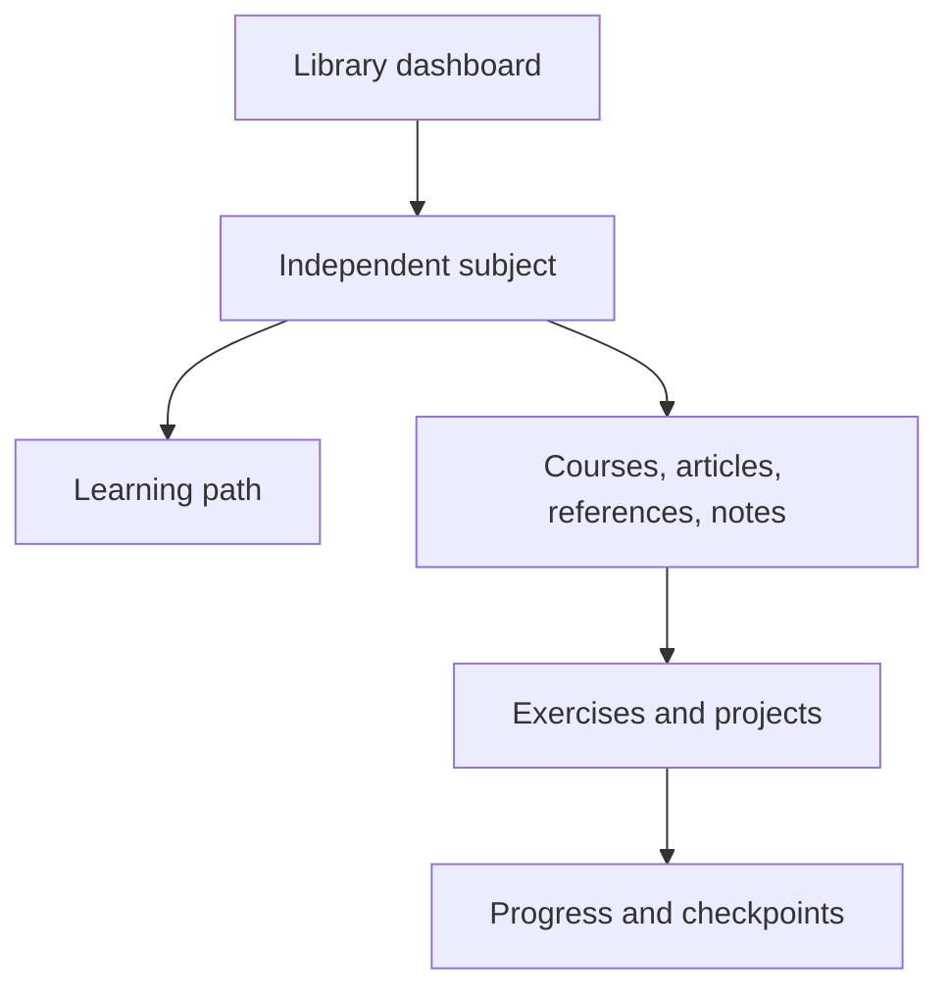

# Library guide

## Navigate the library

Start with the [subject catalogue](index.md#subject-catalogue), then open a
subject's landing page for its chapter map. Use its learning path for a study
sequence and its progress page to record completed work. Search works across
subjects; the sidebar and page headings help you stay within the current one.

## Organize material around its purpose

Every subject lives in its own top-level directory under `docs/`. Within that
directory, use the structure the material needs:

| Material | Useful organization | What to include |
| --- | --- | --- |
| Structured course | Phases, modules, chapters | Prerequisites, outcomes, exercises, projects, checkpoints |
| Technical article or deep dive | Articles grouped by concept | Problem, explanation, tradeoffs, examples, sources |
| Tutorial or lab | A self-contained guide | Prerequisites, steps, expected results, cleanup |
| Cheat sheet or reference | A searchable page or reference collection | Commands, syntax, constraints, concise examples |
| Interview preparation | Questions grouped by skill | Prompts, reasoning, alternatives, review notes |
| Research or study notes | Dated or topic-based notes | Question, observations, uncertainty, references |
| Architecture explanation | A page alongside the relevant concept | Diagram, boundaries, data flow, design decisions |

Subjects may mix these formats. Cross-subject links are welcome, but one subject
must not require another subject's directory layout or tooling to work.

## Markdown conventions

- Use lowercase, hyphenated file and directory names.
- Give every page one descriptive `#` heading. Use `##` and `###` in order.
- Use fenced code blocks with a language name and provide expected output when useful.
- Link to Markdown source files using paths relative to the current page,
  for example `[Learning path](python-backend-engineering/learning-path.md)`.
- Link to headings with readable anchors, such as `learning-path.md#study-cycle`.
- Keep images beside their subject's content, typically in an `assets/` directory.
- Use relative links for library pages and descriptive labels for external sources.
- Record tool versions and assumptions for instructions that may change over time.

## Chapter pattern

A course chapter should explain a concrete concept and give the reader a way to
demonstrate it. Use these sections when appropriate:

1. **Outcomes and prerequisites:** what the learner should already know and achieve.
2. **Explanation:** the model, rationale, examples, and common mistakes.
3. **Practice:** an exercise with a task, constraints, and expected behavior.
4. **Checkpoint:** observable acceptance criteria and review questions.
5. **Next steps:** relative links back to the module and forward to the next chapter.

Articles, references, and research notes can use their own headings. Do not add
empty sections merely to follow the chapter pattern.

### Explain a mechanism through an example

Define the idea in plain language before naming its APIs. Give a small input,
program, request, query or timeline, then show the expected result. Walk through
why each relevant step produces that result, identify a backend consequence and
explain a common mistake or limit. Let an example demonstrate the mechanism rather
than merely decorate a definition.

Keep code blocks formatted and complete for their stated scope. Distinguish
standalone examples from snippets requiring a framework/service or surrounding
context. Mark hypothetical timings and runtime-dependent observations explicitly;
do not present illustrative capacity arithmetic as a measured benchmark. Practical
project placeholders should remain labelled until implementation is requested.

## Runnable examples

Keep executable code under `examples/<subject>/`, outside `docs/`. Each runnable
example should document its working directory, runtime, dependency installation,
execution command, expected result, and cleanup. Keep dependencies local to that
example; the documentation environment should only require the site-building tools.

Explain code in the lesson and identify its repository path. When linking to
example source from the published site, use the repository's source URL rather
than a relative path outside `docs/`; such files are not copied into the site.
For internal library content, always use relative Markdown links.

## Record progress with evidence

Checkboxes are Markdown source, not interactive saved state. Edit the subject's
progress page and commit the change to record progress. For a completed
checkpoint, include the date, exercise or project, result, and a link to your
evidence. Leave unchecked work that you have only read about.

## Architecture diagrams

Mermaid diagrams can live directly in a page. Keep a text explanation with the
diagram so the reasoning remains readable in any Markdown viewer.

The dashboard points into a subject. Its learning path connects the appropriate
material, and completed practice supplies evidence for the subject's checkpoints.

## Add a subject

Create its top-level directory with real content, a landing page, learning path,
and progress/checkpoint page. Add its section to `mkdocs.yml` and its catalogue
entry to the [homepage](index.md). No existing subject needs to move or change.
Use the repository README for build and deployment commands.
