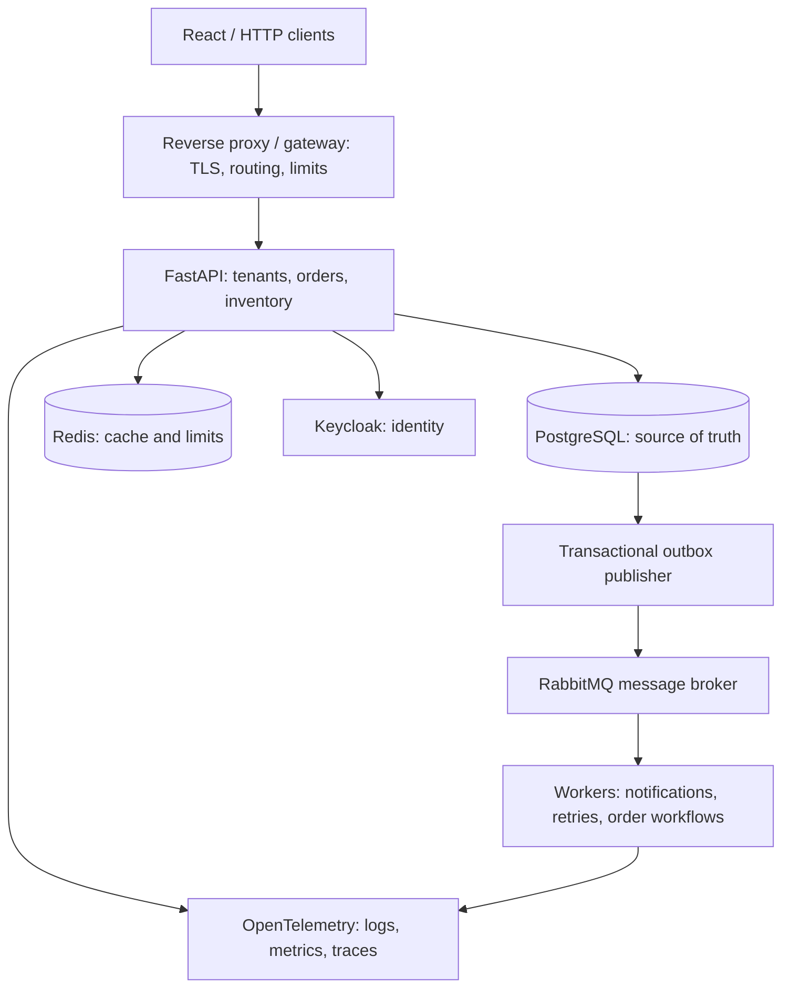

# Python & Backend Engineering — Senior Engineer Learning Path

16-week curriculum · 160 study hours · Python + FastAPI + PostgreSQL + Distributed Systems + System Design

This course supports an experienced, frontend-heavy full-stack engineer moving
toward Senior Python Backend Engineer roles, while strengthening candidacy for
Senior Full-Stack, Applied AI, and infrastructure-oriented software engineering roles.
The goal is to understand internals, recognize production failure modes, make
architectural decisions, and demonstrate those skills in interviews.

!!! info "Scope and provenance"
    This page preserves the supplied whole-course plan, with formatting cleaned up
    and interface artifacts removed. All ten phases and twenty modules now have
    [lessons and assessments](curriculum-map.md). Existing Phase 1–2 examples are
    runnable. Practical projects for Phases 3–10 are intentionally deferred
    placeholders; no new service, deployment or completed capstone is claimed.

## 1. Learning strategy

**16 weeks · 10 hours per week · 160 hours total**

Recommended allocation: theory **35%**, implementation **45%**, interviews **20%**.
160 hours is a realistic target for focused interview preparation and stronger
backend competence, not exhaustive mastery. Prioritize frequent production and
interview needs; reserve deeper specialization for later.

- **P0 — Hiring critical:** understand deeply, implement independently, explain in an interview.
- **P1 — Senior engineering:** understand tradeoffs and apply to realistic systems.
- **P2 — Specialization:** conceptual familiarity first; advanced implementation when needed.

Every module follows: definition → motivation → internals → engineering decisions
→ tradeoffs → code examples → mistakes → interview questions → exercises → mastery
assessment. Refresh fundamentals quickly, emphasizing differences from JavaScript,
TypeScript, Kotlin, and Java rather than relearning basic programming.

## 2. Dependency-based learning path

1. **Python Language Foundations:** semantics, collections, OOP, typing, pytest.
2. **Python Internals & Concurrency:** CPython, memory, threading, asyncio.
3. **HTTP, Networking & API Engineering:** HTTP, TLS, REST, ASGI, FastAPI.
4. **Persistence:** PostgreSQL, transactions, indexing, ORM.
5. **Distributed Workflows:** Redis, queues, retries, consistency.
6. **Production Engineering:** security, observability, testing, Docker, Kubernetes, AWS.
7. **Senior System Design & Interviews:** architecture, scalability, reliability, judgment.

Understand event loops before optimizing async endpoints, transactions before
reliable background processing, and failure modes before distributed-service design.

**Technology baseline:** Python 3.14 for the primary course runtime; study modern
Python 3.15 features separately. Dependency compatibility matters more than using
the newest interpreter. The supplied plan states “Python 3.15.1 was released on
October 21, 2026”; this historical claim is retained as supplied, not independently
verified. Existing Phase 1–2 runnable examples use Python 3.14. Later-phase excerpts
are teaching material; their service/project implementations remain deferred.

## 3. Complete curriculum — 10 phases, 20 modules

### Phase 1 — Python fundamentals: fast review

**Weeks 1–2 · mostly P0** · [Implemented lessons](phase-1/index.md)

**Module 1 — Python language semantics**

- Execution model, indentation, expressions, control flow and truthiness.
- Object identity, references, `is` vs `==`, aliasing, shallow vs deep copying.
- `int`, `float`, `bool`, `str`, `bytes`, `None`, lists, tuples, sets, dictionaries, slicing and comprehensions.
- Functions, positional/keyword parameters, mutable defaults, `*args`, `**kwargs`, keyword-only parameters.
- LEGB scope, closures, lambdas, decorators.
- Iterables, iterators, generators, `yield`, lazy evaluation.
- Exceptions, chaining, custom exception hierarchies, `try/except/else/finally`.
- Context managers, `with`, resource ownership.
- File handling, JSON, CSV, `datetime`, `pathlib`, `collections`, `itertools`, `functools`, regex.

**Module 2 — Professional Python development**

- OOP, composition, inheritance, polymorphism, special methods.
- Dataclasses, enums, properties, abstract base classes.
- Type hints, `TypedDict`, `Protocol`, generics, `TypeVar`, `Callable`.
- Static type checking with mypy or Pyright.
- Python modules, package structure, imports and circular dependencies.
- `pyproject.toml`, virtual environments, dependency locking, `uv`/pip.
- Ruff, formatters, pytest, fixtures, parametrization, mocking and test boundaries.

**Mastery:** write idiomatic Python, predict reference/mutation bugs, and build a small tested package.

### Phase 2 — Advanced Python and internals

**Weeks 2–3 · P0/P1, selected P2** · [Implemented lessons](phase-2/index.md)

**Module 3 — Python data model and runtime**

- Objects, identity, types, lifecycle and memory ownership.
- CPython interpreter, compilation and bytecode, call frames, name resolution.
- Reference counting, cyclic garbage collection, memory allocation.
- Descriptor protocol, properties, method binding, MRO, multiple inheritance, `super()`.
- Advanced decorators, metaclasses and class creation.
- Structural typing, protocols, variance and generic programming.
- Pythonic functional techniques and their limits.
- Serialization with JSON, pickle risks, binary protocols.
- CPU/memory profiling, allocation tracking, benchmarking, complexity.

**Module 4 — Concurrency and asynchronous execution**

- Processes vs threads vs coroutines.
- GIL behavior in standard CPython; free-threaded Python considerations.
- Concurrency vs parallelism, CPU-bound vs I/O-bound workloads.
- Event loop scheduling, coroutines, awaitables, tasks and futures.
- `asyncio.gather`, `TaskGroup`, queues, semaphores and cancellation.
- `ThreadPoolExecutor`, `ProcessPoolExecutor`, `asyncio.to_thread`.
- Blocking operations inside async handlers.
- Race conditions, locks, synchronization and shared-state management.
- Connection pools, resource limits, backpressure and structured concurrency.

**Mastery:** select threads, processes or asyncio; explain performance consequences; diagnose event-loop blocking.

### Phase 3 — Networking, HTTP and backend fundamentals

**Week 4 · P0** · [Lessons and assessment](phase-3/index.md)

**Module 5 — Networking and HTTP**

- Client/server architecture, sockets, TCP/IP, DNS, TLS and connection establishment.
- HTTP/1.1, HTTP/2, HTTP/3, multiplexing and connection reuse.
- Request methods, status codes, headers, content negotiation.
- Safe/idempotent operations, conditional requests, ETags, cache control.
- REST principles, resource modeling, API contracts.
- Pagination, cursor vs offset, filtering, sorting and versioning.
- Cookies, sessions, bearer tokens, authentication and authorization.
- Browser constraints: CORS, CSRF, XSS.
- SSE, WebSockets, streaming and long polling.

**Module 6 — Web-server architecture**

- Reverse proxies, API gateways, load balancers.
- WSGI vs ASGI.
- Uvicorn, request routing, middleware, worker processes.
- Synchronous and asynchronous handler execution.
- Request timeouts, disconnects, cancellation.
- HTTP client connection pooling and keep-alive.
- Request lifecycle from network to business logic to persistence.
- Error boundaries, graceful shutdown and resource cleanup.

**Mastery:** trace a request from browser through proxy, ASGI server, application, database, and back.

### Phase 4 — FastAPI and production API engineering

**Weeks 5–6 · P0** · [Lessons and assessment](phase-4/index.md)

**Module 7 — FastAPI application development**

- Routers, path operations, dependencies, dependency scopes.
- Pydantic validation, strictness, serialization and model boundaries.
- Request/response models and OpenAPI.
- Middleware, exception handlers and consistent error contracts.
- Application lifespan and resource initialization.
- Async vs sync endpoint design.
- Authentication dependencies and dependency overrides.
- File uploads, large-body handling, streaming responses, WebSockets.
- API contract evolution and backwards compatibility.

**Module 8 — Application architecture and testing**

- Domain models vs persistence models vs API models.
- Layered architecture, Clean Architecture, hexagonal architecture.
- Service layer, repository pattern, Unit of Work.
- Dependency inversion and practical dependency injection.
- SQLAlchemy 2.x synchronous and asynchronous sessions.
- Environment configuration and secrets.
- Unit vs integration vs contract vs end-to-end tests.
- Async testing using HTTPX and pytest.
- Testcontainers or ephemeral Docker services.
- Modular monolith organization and safe refactoring.

**Mastery:** implement a maintainable service, justify its architecture, test multiple boundaries.

### Phase 5 — PostgreSQL, SQL and data persistence

**Weeks 7–8 · P0** · [Lessons and assessment](phase-5/index.md)

**Module 9 — Relational modeling and SQL**

- Relational concepts, constraints, primary and foreign keys.
- Normalization, denormalization and schema tradeoffs.
- PostgreSQL data types, UUIDs, JSONB, arrays, timestamps.
- Joins, aggregations, subqueries, CTEs and window functions.
- B-tree, composite, partial, expression and covering indexes.
- Selectivity, index order, statistics and query-planner decisions.
- `EXPLAIN`, `EXPLAIN ANALYZE`, buffer usage.
- SQLAlchemy 2.x queries, relationships, lazy/eager loading.
- N+1 queries, batching and pagination.
- Alembic migrations, schema evolution, expand/contract migrations.

**Module 10 — Transactions, concurrency and scalability**

- ACID and transaction boundaries.
- PostgreSQL MVCC, snapshots and visibility.
- Read Committed, Repeatable Read and Serializable.
- Lost updates, write skew, non-repeatable reads and phantom behavior.
- Optimistic and pessimistic concurrency control.
- `SELECT ... FOR UPDATE`, locking and deadlocks.
- Retryable transactions, serialization failures.
- Connection pools and pool exhaustion.
- Partitioning, replication, read replicas and replication lag.
- Backup and restore, WAL, recovery, high availability.
- NoSQL models: document, key-value, wide-column and graph databases.

**Mastery:** analyze slow queries, fix N+1, explain anomalies, safely modify data concurrently.

### Phase 6 — Redis, messaging and distributed systems

**Weeks 9–10 · P0/P1** · [Lessons and assessment](phase-6/index.md)

**Module 11 — Caching and coordination**

- Redis architecture, basic data structures and commands.
- Cache-aside, write-through, write-behind.
- TTLs, stale data and invalidation policies.
- Cache stampedes, hot keys, cache penetration.
- Distributed rate limiting, counters and atomic operations.
- Redis Pub/Sub vs Redis Streams.
- Distributed locks, leases, fencing-token concepts.
- Cache outage behavior, circuit breaking and graceful degradation.

**Module 12 — Messaging and distributed workflows**

- Message queues vs event logs vs Pub/Sub.
- RabbitMQ, Kafka, SQS and broker selection criteria.
- Celery or equivalent background workers.
- Acknowledgments, visibility timeouts and redelivery.
- At-most-once vs at-least-once delivery.
- Idempotent consumers and deduplication.
- Exponential backoff, retry budgets, dead-letter queues.
- Transactional outbox and dual-write failure.
- Sagas, compensating actions and eventual consistency.
- Timeouts, bulkheads, circuit breakers and backpressure.
- CAP theorem in real-world engineering decisions.

**Mastery:** tolerate consumer crashes, duplicate messages, unavailable dependencies, partial failures.

### Phase 7 — Security, observability and reliability

**Weeks 11–12 · P0/P1** · [Lessons and assessment](phase-7/index.md)

**Module 13 — Backend application security**

- OAuth 2.0, OpenID Connect, Authorization Code + PKCE.
- Keycloak integration, public vs confidential clients.
- Access tokens, refresh tokens, JWT signatures, JWKS, issuer and audience validation.
- Scopes, RBAC, ABAC, object-level authorization.
- Session security and CSRF protections where applicable.
- Tenant isolation and horizontal privilege escalation.
- OWASP API Security Top 10.
- SQL injection, SSRF, unsafe deserialization, dependency vulnerabilities.
- Service identities, secret rotation and least privilege.
- Security logging and audit trails.

**Module 14 — Operational reliability**

- Structured logging, correlation IDs and trace propagation.
- Metrics, logs, traces and OpenTelemetry.
- Prometheus, Grafana and distributed tracing.
- Latency distributions, p50/p95/p99 and throughput.
- SLIs, SLOs, error budgets and alerting.
- Readiness, liveness and startup probes.
- Load tests, stress tests, profiling and capacity estimates.
- Memory leaks, connection leaks and resource exhaustion.
- Incident response, root cause analysis and postmortems.

**Mastery:** distinguish code, dependency, resource, and infrastructure failures; prevent recurrence.

### Phase 8 — Cloud, DevOps and backend infrastructure

**Weeks 13–14 · P0/P1** · [Lessons and assessment](phase-8/index.md)

**Module 15 — Containers, automation and AWS**

- Docker images, multi-stage builds, networking and volumes.
- Docker Compose development environments.
- CI pipelines: lint, type checks, unit and integration tests, image builds.
- Terraform providers, resources, modules and state.
- AWS EC2, ECS/Fargate, EKS, Lambda.
- RDS, ElastiCache, S3, SQS, IAM and networking.
- Managed vs self-managed services and costs.
- VPC design, security groups, private subnets and service connectivity.

**Module 16 — Kubernetes and delivery**

- Pods, Deployments, Services, Ingress, networking.
- ConfigMaps, Secrets and service accounts.
- Resource requests, limits, HPA and scaling behavior.
- Readiness, liveness and graceful termination.
- Helm, Argo CD and GitOps.
- Rolling releases, canary and blue-green deployments.
- Rollbacks, database migration compatibility.
- Monitoring, alerting, deployment diagnostics.
- High availability, backup and cost-aware infrastructure choices.

**Mastery:** ship an API, diagnose unhealthy deployments, reason about reliability and cost.

### Phase 9 — Advanced architecture and system design

**Week 15 · P1/P2** · [Lessons and assessment](phase-9/index.md)

**Module 17 — Software architecture**

- SOLID, cohesion and coupling.
- Domain-driven design and bounded contexts.
- Aggregates, invariants and consistency boundaries.
- Monolith vs modular monolith vs microservices.
- Service decomposition, API contracts and independent deployment.
- Repository, Strategy, Adapter, Factory and related patterns.
- CQRS, event sourcing and when to avoid them.
- Architectural decision records and design reviews.

**Module 18 — Distributed system design**

- Capacity estimation and identifying bottlenecks.
- Horizontal/vertical scaling and load balancing.
- Database replication and sharding.
- Consistent hashing, partitioning and hotspot management.
- Availability, durability and consistency tradeoffs.
- Disaster recovery, RPO/RTO, multi-region architecture.
- Designing APIs, caches, queues and persistent storage together.
- Cost, latency, complexity and reliability optimization.

**Design exercises:** URL shortener, notifications, rate limiter, event ingestion,
order processing, real-time messaging, document-search/RAG platform, multi-tenant SaaS.
Each covers functional/nonfunctional requirements, capacity assumptions, APIs, data
model, architecture, bottlenecks, failure recovery, and tradeoffs.

### Phase 10 — Senior engineering interviews

**Week 16, with practice throughout · P0** · [Lessons and assessment](phase-10/index.md)

**Module 19 — Coding and technical problem solving**

- Arrays, strings, dictionaries, sets, stacks, queues.
- Binary search, sorting, two pointers, sliding windows.
- Trees, graphs, heaps, recursion and basic dynamic programming.
- Big-O time/space analysis.
- Python-specific tricky behavior and implementation tasks.
- SQL challenges, indexing and query optimization.
- Concurrency and backend debugging exercises.
- API implementation within a time limit.
- Reviewing unfamiliar code and proposing refactors.

**Module 20 — Senior interview simulation**

- Backend architecture whiteboard discussions.
- System design: requirements, estimates, tradeoffs and failure scenarios.
- Production incident and troubleshooting interviews.
- Code review and implementation assessment.
- Behavioral stories using STAR, centered on decisions, ownership, conflict, measurable impact.
- Communicating uncertainty and assumptions.
- Explaining tradeoffs clearly without overengineering.

**Mastery:** solve a bounded problem under interview conditions and explain its production limits.

## 4. Week-by-week learning roadmap

Each week is approximately 10 hours. Time splits below mean theory / implementation / interview.
Phase boundaries overlap in week 2; they do not add hours to the weekly budget.

### Weeks 1–4: Python foundations and backend mechanics

**Week 01 — Python language refresher · 3/5/2h**

- Learn references/mutability, collections, functions, closures, generators, exceptions, context managers.
- Exercise: implement a pure-Python inventory manager with typed functions, dataclasses, unit tests.
- Interview: mutable defaults; `is` vs `==`.
- Checkpoint: predict 12 snippets and explain them; deliver a tested Python package.
- Resources: Python Tutorial, Python Data Model, pytest.

**Week 02 — Advanced Python and clean code · 4/4/2h**

- Study decorators, descriptors, inheritance, MRO, Protocols, generics, CPython memory, package design.
- Exercise: reusable service interface with multiple implementations; strict typing and profiling.
- Interview: method resolution; `Protocol` vs inheritance.
- Checkpoint: refactor poorly structured code, explain improvements, pass type checks.
- Resources: Python Data Model, PyPA, Python reference.

**Week 03 — Asyncio, concurrency and performance · 4/4/2h**

- Study scheduling, tasks, cancellation, races, GIL, threads, process pools.
- Exercise: concurrent API aggregation client; measure throughput and introduce event-loop blocking.
- Interview: why async endpoints can be slower; when threads improve performance.
- Checkpoint: diagnose blocking; add timeouts/bounds; demonstrate improvement.
- Resources: Python asyncio, Free-threading Guide.

**Week 04 — HTTP, networking and ASGI · 4/4/2h**

- Study DNS, TLS, HTTP semantics, idempotency, caching, proxies, request lifecycles.
- Exercise: start FastAPI, implement initial endpoints, inspect traffic, trace middleware.
- Interview: HTTP request lifecycle; retrying POST.
- Checkpoint: draw request flow, document API contract, status codes, errors.
- Resources: MDN HTTP, FastAPI User Guide.

### Weeks 5–8: Production APIs and PostgreSQL

**Week 05 — FastAPI and application design · 3/5/2h**

- Learn routers, dependencies, Pydantic, validation, errors, middleware, OpenAPI.
- Exercise: tenants/products/orders endpoints; separate API schemas and domain models.
- Interview: dependency injection; validation vs domain logic.
- Checkpoint: REST API with negative tests, consistent errors, API documentation.
- Resources: FastAPI, Pydantic, pytest.

**Week 06 — Clean architecture and API testing · 3/5/2h**

- Study services, repositories, dependency inversion, session lifecycles, test isolation.
- Exercise: SQLAlchemy, Alembic, integration tests, configuration, lifespan management.
- Interview: repository commits; database session lifetime.
- Checkpoint: refactor without changing API behavior; architecture notes, migrations, tests.
- Resources: SQLAlchemy, Cosmic Python, pytest.

**Week 07 — PostgreSQL and query optimization · 4/4/2h**

- Study modeling, joins, CTEs, windows, indexes, plans, N+1.
- Exercise: realistic records, benchmark slow queries, optimize a reporting endpoint.
- Interview: ignored indexes; composite index order.
- Checkpoint: measured before/after query plans and performance.
- Resources: PostgreSQL SQL & EXPLAIN, SQLAlchemy ORM.

**Week 08 — Transactions and database concurrency · 4/4/2h**

- Learn ACID, MVCC, isolation, row locks, optimistic concurrency, deadlocks.
- Exercise: competing orders, safe reservations, transaction retries.
- Interview: incorrect inventory from successful requests; Serializable retries.
- Checkpoint: concurrent tests prove valid inventory and safe duplicate submissions.
- Resources: PostgreSQL Concurrency Control.

### Weeks 9–12: Distributed systems and reliability

**Week 09 — Redis and caching · 3/5/2h**

- Learn cache-aside, TTL, invalidation, stampedes, rate limiting, consistency.
- Exercise: cache catalog reads, rate limiter, Redis outage simulation.
- Interview: preventing stampedes; stale inventory.
- Checkpoint: hit/miss metrics, invalidation tests, cache failure cannot corrupt orders.
- Resources: Redis Documentation.

**Week 10 — Queues, workers and event-driven processing · 3/5/2h**

- Study RabbitMQ/Kafka/SQS/Celery, acknowledgments, delivery guarantees, retries, outbox.
- Exercise: order-created events, async notifications, worker crashes, duplicate deliveries.
- Interview: commit/event gap; exactly-once delivery vs side effects.
- Checkpoint: broker/worker recovery without duplicate business effects.
- Resources: RabbitMQ, Celery, AWS SQS, Kafka.

**Week 11 — Authentication, authorization and security · 3/5/2h**

- Study OAuth2/OIDC, Keycloak, JWT validation, RBAC, tenant isolation, threats.
- Exercise: Keycloak, tenant permissions, negative authorization tests.
- Interview: JWT checks; cross-tenant data access.
- Checkpoint: reject cross-tenant access, expired/wrong-audience tokens, unauthorized operations.
- Resources: Keycloak, OWASP API Security.

**Week 12 — Observability and production troubleshooting · 3/5/2h**

- Study logs/traces/metrics, exhaustion, SLIs/SLOs, profiling, load testing.
- Exercise: OpenTelemetry, dashboard, slow queries, overloaded pools.
- Interview: rising p99 with low CPU.
- Checkpoint: incident report with evidence, root cause, correction, regression test.
- Resources: OpenTelemetry, Google SRE Workbook.

### Weeks 13–16: Delivery, architecture and interviews

**Week 13 — Docker, CI/CD and deployment · 2/6/2h**

- Review images, Compose, CI, configuration, secrets, AWS services.
- Exercise: containerize services, automate tests, repeatable deployment pipeline.
- Interview: local vs container failures; deployment migrations.
- Checkpoint: documented fresh-checkout startup and test commands.
- Resources: Docker/Kubernetes, AWS Well-Architected, Twelve-Factor App.

**Week 14 — Kubernetes, scaling and cloud reliability · 3/5/2h**

- Study workload lifecycle, probes, scaling, Terraform, managed services, rollouts.
- Exercise: local Kubernetes, rolling upgrades, failed readiness, rollback; AWS equivalent.
- Interview: rollout 503s; ECS vs EKS.
- Checkpoint: Kubernetes configuration, runbook, AWS proposal.
- Resources: Kubernetes, Terraform, AWS Well-Architected.

**Week 15 — System design and architectural judgment · 5/3/2h**

- Study DDD, bounded contexts, scaling, consistency, tradeoffs.
- Exercise: notification, rate limiter, ingestion designs; review capstone architecture.
- Interview: multi-tenant notifications for millions of daily events.
- Checkpoint: three design documents with capacity, diagrams, failures, choices.
- Resources: Cosmic Python, Google SRE, AWS Well-Architected.

**Week 16 — Senior engineering interview simulation · 2/3/5h**

- Review Python/concurrency/SQL/architecture/incidents/design.
- Exercise: timed coding, API implementation, SQL optimization, debugging.
- Interview: coding, backend deep dive, system design, behavioral loop.
- Checkpoint: competency report, weak areas, portfolio docs, targeted revision actions.
- Resources: previous modules, prioritizing weak topics.

## 5. Priority and depth matrix

| Knowledge area | Priority | Required depth |
| --- | --- | --- |
| Python semantics, collections, functions, OOP | P0 | Deep |
| Python typing, testing and packaging | P0 | Deep |
| Asyncio, event loops, cancellation, GIL | P0 | Deep |
| HTTP, REST, auth and ASGI | P0 | Deep |
| FastAPI, SQLAlchemy, Pydantic | P0 | Deep |
| PostgreSQL SQL, indexes, transactions, MVCC | P0 | Deep |
| Redis, caching and invalidation | P0 | Deep |
| Queue processing, retry, idempotency, outbox | P0 | Deep |
| OAuth/OIDC, JWT validation, API security | P0 | Deep |
| Backend testing, Docker and CI/CD | P0 | Deep |
| Coding and system design interviews | P0 | Deep |
| Logging, metrics, tracing and debugging | P1 | Working depth |
| Kubernetes, AWS and Terraform | P1 | Working depth |
| DDD, modular architecture, design patterns | P1 | Working depth |
| Database replication and partitioning | P1 | Working depth |
| CPython internals, profiling and descriptors | P1 | Working depth |
| Kafka architecture and event streaming | P1 | Working depth |
| Free-threaded Python internals, metaclasses | P2 | Conceptual |
| Multi-region systems, consistent hashing | P2 | Conceptual |
| Event sourcing, CQRS, complex sagas | P2 | Conceptual |
| Advanced sharding and consensus protocols | P2 | Conceptual |

Deep means code it, explain mechanisms, recognize failures, and evaluate alternatives.
Conceptual means understand how it works, when it matters, and its major tradeoffs.

## 6. Evolving production backend project

**FulfillHub — a multi-tenant order processing SaaS.** Organizations are tenants;
their users manage catalogs, inventory, and customer orders. Orders trigger
asynchronous workflows, notifications, and audit events. Preserve inventory,
prevent cross-tenant access, and tolerate duplicate requests and worker failures.

### Target architecture

Connections are conceptual. API and workers run in containers; CI/CD and Kubernetes
arrive in the infrastructure phase. This is an end-of-course target, not the scope
of the first two phases' in-memory examples.

### Core database entities

| Entity | Responsibility |
| --- | --- |
| `tenants` | Organization-level isolation |
| `users`, `memberships` | Users and tenant roles |
| `products` | Product catalog |
| `inventory` | Available and reserved quantities |
| `orders`, `order_items` | Order lifecycle |
| `outbox_events` | Durable events awaiting publication |
| `processed_events` | Consumer deduplication |
| `idempotency_keys` | Safe API retries |
| `audit_logs` | Security and business auditability |

### Project evolution and deliberate failures

| Weeks | Feature introduced | Problem to diagnose |
| --- | --- | --- |
| 1–2 | Domain models and services | Mutation bugs, poor typing |
| 3–4 | Concurrent clients and API | Blocking event loop, timeout handling |
| 5–6 | FastAPI, PostgreSQL, migrations | Coupling, session lifecycle, invalid input |
| 7–8 | Inventory and transactions | Lost updates, overselling, slow queries |
| 9–10 | Redis, queues and events | Stale cache, duplicate delivery, lost events |
| 11–12 | Auth and observability | Cross-tenant access, slow requests, pool exhaustion |
| 13–14 | Containers, CI/CD, Kubernetes | Failed rollout, resource limits, readiness failures |
| 15–16 | Architecture review and hardening | Scale limits, operational risks, tradeoffs |

### Example engineering challenge

Two customers purchase the last item simultaneously. Reading `stock = 1` in both
transactions can allow both orders and invalidate inventory. Choose concurrency
control, preserve the invariant, handle retries, and prove correctness with
concurrent integration tests. Later add a transactional outbox to avoid losing
events when the application or broker fails.

### Definition of project completion

- A fresh developer environment runs reproducibly.
- Migrations and automated tests work reliably.
- Authentication, authorization, tenant isolation are enforced.
- Concurrent order processing preserves invariants.
- Consumers tolerate duplicate delivery and retries.
- Logs, metrics, traces support investigation.
- Load tests expose measurable performance characteristics.
- Deployment and recovery procedures are documented.
- The README explains architectural choices and tradeoffs.

Optional after the core course: tenant-aware document search/RAG, reusing Applied
AI experience without distracting from backend fundamentals.

## 7. Assessment and progress measurement

| Dimension | Points |
| --- | ---: |
| Conceptual understanding | 25 |
| Implementation correctness | 30 |
| Debugging and failure analysis | 20 |
| Architecture and tradeoffs | 15 |
| Communication | 10 |
| **Total** | **100** |

**Passing target: 80/100.** Correct code alone is insufficient. Explain failure
modes, complexity, and engineering choices. Weekly checks combine concept questions,
coding/debugging, application-level design, and review of prior topics. Weeks 4,
8, 12, 16 are larger cumulative checks. Begin the next session with exposed weak
areas rather than advancing automatically. Record actual results in
[progress & checkpoints](progress.md).

## 8. Senior Python Backend Engineer competency checklist

Initial baseline: **0 of 18 demonstrated (0%)**. Mark only with evidence.

### Python and concurrency

- [ ] Explain references, mutability, closures and the Python object model.
- [ ] Use typing, generics, Protocols, decorators and context managers confidently.
- [ ] Explain GIL behavior, asyncio scheduling, cancellation and blocking operations.
- [ ] Diagnose CPU, memory and concurrency bottlenecks.

### API and persistence

- [ ] Design a versioned HTTP API with correct semantics and errors.
- [ ] Build and test a layered FastAPI application independently.
- [ ] Optimize PostgreSQL queries using indexes and execution plans.
- [ ] Explain MVCC, isolation levels, locks, deadlocks and retries.
- [ ] Write safe schema migrations and manage database sessions.

### Distributed systems and security

- [ ] Design caching with explicit invalidation and failure behavior.
- [ ] Build idempotent message consumers and reliable event publication.
- [ ] Explain eventual consistency, retries, timeouts and failure handling.
- [ ] Implement secure JWT validation, RBAC and tenant isolation.

### Production and architecture

- [ ] Use logging, metrics and traces to diagnose an incident.
- [ ] Containerize, test, deploy and troubleshoot an application.
- [ ] Estimate capacity and design scalable backend services.
- [ ] Justify modular monolith vs microservices and other architectural tradeoffs.
- [ ] Complete coding, SQL, debugging and design exercises under time limits.

## 9. Learning resources

The supplied plan described these resources as verified. That provenance does not
claim a fresh availability check by this repository. Use targeted chapters rather
than reading manuals sequentially.

### Python and fundamentals

- [Python 3.14 Tutorial](https://docs.python.org/3.14/tutorial/)
- [Python Data Model](https://docs.python.org/3.14/reference/datamodel.html)
- [Python asyncio](https://docs.python.org/3.14/library/asyncio.html)
- [Free-threaded Python](https://docs.python.org/3.14/howto/free-threading-python.html)
- [Python Packaging User Guide](https://packaging.python.org/en/latest/tutorials/packaging-projects/)
- [pytest](https://docs.pytest.org/en/stable/)

### API development and databases

- [MDN HTTP Overview](https://developer.mozilla.org/en-US/docs/Web/HTTP/Guides/Overview)
- [FastAPI](https://fastapi.tiangolo.com/tutorial/)
- [Pydantic](https://docs.pydantic.dev/latest/)
- [SQLAlchemy 2.x](https://docs.sqlalchemy.org/en/20/)
- [PostgreSQL Concurrency Control](https://www.postgresql.org/docs/current/mvcc.html)
- [PostgreSQL EXPLAIN](https://www.postgresql.org/docs/current/using-explain.html)

### Caching, messaging and security

- [Redis](https://redis.io/docs/latest/develop/)
- [RabbitMQ](https://www.rabbitmq.com/docs)
- [Celery](https://docs.celeryq.dev/en/stable/)
- [Kafka](https://kafka.apache.org/documentation/)
- [AWS SQS](https://docs.aws.amazon.com/AWSSimpleQueueService/latest/SQSDeveloperGuide/welcome.html)
- [Keycloak](https://www.keycloak.org/documentation)
- [OWASP API Security Top 10](https://owasp.org/API-Security/editions/2023/en/0x00-header/)

### Architecture, infrastructure and reliability

- [Architecture Patterns with Python](https://www.cosmicpython.com/book/preface.html)
- [Google SRE Workbook](https://sre.google/workbook/table-of-contents/)
- [OpenTelemetry Python](https://opentelemetry.io/docs/languages/python/instrumentation/)
- [Kubernetes Concepts](https://kubernetes.io/docs/concepts/)
- [Terraform](https://developer.hashicorp.com/terraform/docs)
- [AWS Well-Architected](https://docs.aws.amazon.com/wellarchitected/latest/framework/welcome.html)
- [Twelve-Factor App](https://12factor.net/)

## 10. How to work through the curriculum

Use this as a technical mentoring and assessment program. For a requested module,
study first principles, compare relevant JavaScript/JVM concepts, run Python,
analyze behavior, complete backend exercises, then answer interview questions and
take the assessment. Useful mentoring prompts:

- **Start Module 1:** begin the language refresher and progress through lessons.
- **Assess me:** take an interactive technical assessment with feedback and scoring.
- **Deep dive into asyncio:** explore internals, edge cases, production failure scenarios.

The library supplies study material and assessment prompts; interactive mentoring
happens in conversation. Build evidence of technical judgment through assessments
and design work, and a working backend whose behavior, architecture, and operational
tradeoffs you can defend. Understand the problem a technology solves before its API.

[Subject overview](index.md) · [Implemented learning path](learning-path.md)
