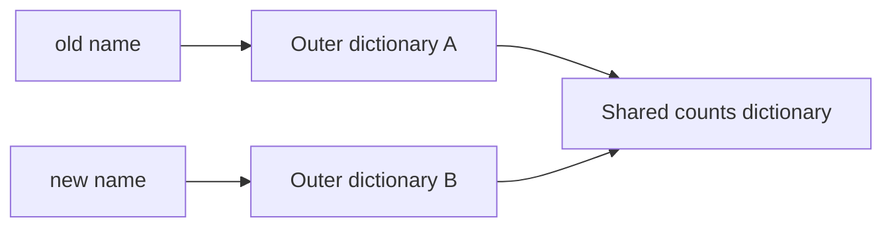

# Module 1 — Ownership, functions, and streaming data

**P0 · read after the [core chapters](index.md)**

By the end, you should be able to explain a reference graph, repair a closure or
mutation bug, and build a one-pass file pipeline with explicit cleanup. Try each
prediction before opening its solution. The running problem is an inventory report
that must not corrupt caller-owned input or leave a file open after a failed row.

## Translate the mental model before the syntax

| Familiar habit | Python behavior | Consequence |
| --- | --- | --- |
| JavaScript empty arrays/objects are truthy | Empty lists/dicts are false | `value or fallback` can replace a deliberately empty collection |
| JavaScript `===` compares objects by identity | `is` checks identity; `==` usually compares values | Do not mechanically translate all `===` to `is` |
| TypeScript types disappear at runtime | Python annotations also do not validate calls | Validate external data before constructing domain values |
| Java/Kotlin variables have declared static types | Python names bind to runtime objects | Rebinding a name does not change aliases to its previous object |
| JS spread and Kotlin `copy()` are often shallow | `list.copy()` and dataclass replacement also share nested values | Decide which nested values may be shared |
| JS `let` introduces a loop-local binding | Python `for` does not introduce a block scope | Loop-created closures can read the final loop binding |

Python `==` is not JavaScript's coercive equality: `"1" == 1` is false. There are
still numeric relationships worth knowing: `True == 1` and `1 == 1.0` are true,
and equal numeric keys can identify the same dictionary entry. Do not use a mixed
bool/int key space to represent distinct domain identities.

## Investigation 1 — Why a successful update changed yesterday's report

An engineer wants an updated copy of a report while preserving the old one:

```python
old = {"tenant": "acme", "counts": {"keyboard": 3}}
new = old.copy()
new["counts"]["keyboard"] -= 1
print(old["counts"]["keyboard"])
```

Predict the printed value and draw which containers exist before fixing anything.



??? note "Solution: the answer is 2"
    `copy()` makes B but reuses the reference to C. Updating C is visible through
    both outer dictionaries. Copying the outer dict again cannot fix the shared
    nested ownership. Rebuild the nested value you are changing:

    ```python
    old = {"tenant": "acme", "counts": {"keyboard": 3}}
    counts = {**old["counts"], "keyboard": old["counts"]["keyboard"] - 1}
    new = {**old, "counts": counts}
    assert old["counts"]["keyboard"] == 3
    assert new["counts"]["keyboard"] == 2
    ```

    For a small domain record, a frozen dataclass with immutable field values is
    often clearer. For a large graph, define the changed path rather than blindly
    deep-copying every reachable object. `deepcopy` has a place, but cannot express
    business ownership or safely duplicate every resource.

### Assignment, augmented assignment, and mutation

Even similar-looking expressions can have different alias behavior:

```python
left = [1]
alias = left
left += [2]
assert alias == [1, 2]

left = [1]
alias = left
left = left + [2]
assert alias == [1]
```

For lists, `+=` extends the existing object; `+` builds a new list and the
assignment rebinds `left`. The exact augmented-assignment behavior is type-defined.
For an immutable integer, `count += 1` rebinds to a result rather than mutating an
integer object. Read an operation's protocol before concluding it preserves identity.

## Investigation 2 — Definition-time state vs call-time state

Defaults, decorators, and closures involve different moments:

1. A `def` statement executes and evaluates default expressions.
2. Decorators transform the function object at definition time.
3. A call binds arguments to parameters and executes the body.
4. A returned closure may read an enclosing binding much later.

```python
def record(value, history=[]):
    history.append(value)
    return history

first = record("created")
second = record("reserved")
```

`first` and `second` reference the same definition-time list. Before repairing
the default, decide whether the intended function should mutate an explicitly
supplied history or return a new one. These are two different valid APIs:

```python
def append_event(history: list[str], event: str) -> None:
    history.append(event)  # mutation is the entire advertised operation

def with_event(history: list[str], event: str) -> list[str]:
    return [*history, event]  # the caller keeps the previous version
```

Replacing the default with `None` prevents cross-call sharing, but it does not
answer what should happen to caller-owned input. Document that decision and test it.

### Argument binding as an API design tool

```python
def reserve(tenant: str, sku: str, /, *, quantity: int) -> tuple[str, str, int]:
    return tenant, sku, quantity

assert reserve("acme", "keyboard", quantity=2) == ("acme", "keyboard", 2)
```

`reserve(tenant="acme", ...)` fails because `tenant` is positional-only;
`reserve("acme", "keyboard", 2)` fails because quantity is keyword-only. The
inventory package uses keyword-only quantity but allows tenant/SKU by keyword;
this teaching signature demonstrates the extra positional-only choice.

Use `*args`/`**kwargs` for a forwarding decorator when the wrapped contract supplies
the meaning. For a business service, named parameters make unsupported arguments
fail early. A decorator should preserve return values and exception behavior;
[Module 3's worked lab](../../phase-2/module-3/runtime-investigations.md#decorators-preserve-more-than-a-name)
shows a typed implementation and checks both paths.

### Closure solution with two honest alternatives

```python
from functools import partial

def label(tenant: str) -> str:
    return f"tenant:{tenant}"

callbacks = [lambda tenant=tenant: label(tenant) for tenant in ("acme", "other")]
partials = [partial(label, tenant) for tenant in ("acme", "other")]
assert [function() for function in callbacks] == ["tenant:acme", "tenant:other"]
assert [function() for function in partials] == ["tenant:acme", "tenant:other"]
```

Both bind the current value. A small named factory is another readable option.
`nonlocal` permits rebinding an enclosing name; it does not create a separate
snapshot for every callback. Prefer `partial` when it communicates ordinary argument
binding more clearly than a lambda.

## Worked lab — A validated inventory CSV report

The complete implementation is `src/fulfillhub/reporting.py` in the subject's
examples package. The committed input is `data/inventory.csv`:

```csv
tenant,sku,stock
acme,keyboard,3
acme,monitor,2
other,keyboard,7
```

The contract is deliberately small:

- The header must be exactly `tenant,sku,stock` in that order.
- Blank rows are skipped. Other rows must have exactly three fields.
- Tenant names must be nonempty after trimming.
- SKUs use 1–32 ASCII letters/digits/hyphens and begin with a letter/digit.
- Stock is a non-negative decimal integer; `True`, `1.5`, `-1`, and `03` are rejected.
- Repeated rows are counted as rows. This is an aggregation report, not an upsert
  or deduplicated product catalogue.

Rejecting leading zeroes is a chosen input contract, not a Python restriction.
Decide such rules explicitly instead of letting `int()` accidentally define the API.

### Keep lazy consumption inside the owner's lifetime

This common implementation returns an iterator backed by a closed file:

```python
def broken_lines(path):
    with path.open(encoding="utf-8") as stream:
        return (line.strip() for line in stream)
```

The `with` exits before the caller starts iterating. Materializing a list inside
the `with` would fix the lifetime but load the whole file. The reference instead
exports a context manager whose scope owns the file and its lazy iterator:

```python
from datetime import UTC, datetime
from pathlib import Path
from fulfillhub.reporting import open_products, summarize

with open_products(Path("data/inventory.csv")) as products:
    report = summarize(products, at=datetime(2026, 10, 30, tzinfo=UTC))

assert report["total_units"] == 12
assert report["units_by_tenant"] == {"acme": 5, "other": 7}
```

The file opens on context entry. Header/row parsing happens when iteration advances.
That distinction determines where an exception handler must sit: encompass both
entering the context and consuming its iterator. If the consumer stops after one
row or raises its own exception, exiting the context still closes the stream.

### Error boundaries and predictable output

The parser translates row failures into `CsvInventoryError` with the reader's line
number and chains the original cause. `csv.Error` becomes a malformed-CSV error.
Missing files remain filesystem errors; the parser does not falsely label every
failure as bad business data.

The summarizer accepts any iterable and consumes it once. It uses `Counter` to
total stock per tenant, checks that the supplied timestamp is timezone-aware, and
normalizes it to UTC before JSON serialization. Tests inject a fixed timestamp;
the CLI uses the current time. Sorting tenant keys gives stable presentation.

Streaming avoids retaining every row, but the summary retains one counter entry
per distinct tenant. Memory is O(t) for t tenants, not a universal constant. Sorting
those keys adds O(t log t) work after O(n) row aggregation.

### Run and verify

From `examples/python-backend-engineering/`:

```bash
uv run --frozen python -m fulfillhub.reporting data/inventory.csv
uv run --frozen pytest tests/test_reporting.py -v
```

The report has three product rows, twelve units, and per-tenant totals of five and
seven. The generated timestamp varies. Tests check malformed inputs, line/cause
preservation, one-shot consumption, timezone handling, and closure after partial
consumption or consumer failure.

## Practice extensions

1. Add an optional row limit with `itertools.islice`. Explain whether reaching the
   limit should ignore invalid rows later in the file or trigger full validation.
2. Produce a top-ten tenant report. State whether selection should happen before
   or after aggregation and how ties are ordered.
3. Compare raising on the first bad row with collecting a bounded list of errors.
   Preserve a clear distinction between an entirely valid report and partial data.
4. Support a configurable header order while rejecting duplicate/missing columns.
   Write failure tests before changing the parser.

These extensions are not implemented by the reference. They are opportunities to
justify an API contract rather than copy a longer function.

## Interview model answers

**Why is a shallow copy dangerous?** It is only dangerous when the caller assumes
nested isolation that the copy never promised. Draw the reference graph, identify
the mutable shared child, and choose explicit reconstruction or a different domain
representation. “Always deepcopy” avoids discussing the actual ownership problem.

**Why not catch every exception and return an empty report?** An empty report would
conflate an empty input with invalid data, a missing file, and a programming defect.
Callers need those outcomes to decide whether to retry, correct data, or investigate.

**Is a generator always better?** No. It saves intermediates, but is one-shot,
defers errors, and can retain resources. For a small result that must be revisited,
an eagerly built tuple can be the clearer API.

[Core chapters](index.md) · [Practice](practice.md) ·
[Next: typed design walkthrough](../module-2/design-and-testing.md)
