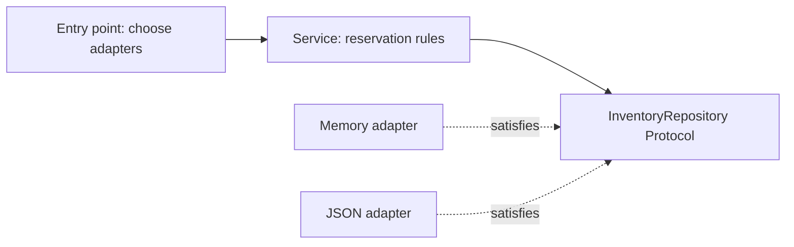

# Module 2 — From a script to a tested package

**P0 · design walkthrough and worked review**

The [core chapters](index.md) introduce the tools. This walkthrough explains the
sequence of decisions behind the inventory package and how to prove the important
guarantees. The objective is a small design that earns its abstractions through
specific requirements.

## Start with the invariant, then choose the interface

For a single successful reservation:

```text
new_stock = old_stock - quantity
quantity > 0
new_stock >= 0
only the selected (tenant, sku) changes
```

On any rejected reservation, the stored state must equal the state before the call.
These statements give you test cases before you choose a web framework, class
hierarchy, or persistence library.

The prototype in [the practice challenge](practice.md#refactoring-challenge) violates
them because it subtracts before checking, returns its mutable global dictionary,
and keys only by SKU. Adding a type annotation to that function does not fix any
of those behavioral defects.

## Step 1 — Make domain values honest

The reference Product is a frozen dataclass with tenant, SKU, and stock. Its
construction checks nonempty identifiers and a non-negative integer stock value.
Checking `bool` separately matters because `isinstance(True, int)` is true.

```python
from dataclasses import replace
from fulfillhub.inventory import Product

before = Product("acme", "keyboard", 3)
after = replace(before, stock=1)
assert before.stock == 3
assert after.stock == 1
```

`replace` constructs a new value and runs initialization; it is not a magical
mutation transaction. For this record, strings/integers are immutable. Adding a
mutable `tags: list[str]` later would require reconsidering ownership despite
`frozen=True`. Prefer a tuple of tags if callers need a stable value.

Enums express a finite vocabulary. The stock status property derives from stock
rather than storing a second field that could disagree with it. Avoid an eagerly
stored `is_available` flag unless there is an independent business reason for it.

## Step 2 — Put behavior behind the smallest useful boundary



The Protocol declares `get`, `save`, and `all`; the adapters structurally satisfy
those operations. The service does not inspect their class names. The entry point
chooses an adapter and injects it, keeping construction separate from business work.

Why not create `MemoryInventoryService` and `JsonInventoryService` subclasses?
Reservation policy would be copied or tangled with storage inheritance. Why not
add interfaces for every function? A pure, small transformation needs no replaceable
runtime boundary. Use the abstraction where two implementations and contract tests
already justify it.

### ABC comparison

```python
from abc import ABC, abstractmethod

class LifecyclePlugin(ABC):
    @abstractmethod
    def start(self) -> None:
        """Acquire the plugin's resources."""

    def stop(self) -> None:
        """A shared default lifecycle hook."""
```

An ABC can be useful when participation in a nominal family and shared lifecycle
are requirements. It is not automatically more professional than a Protocol.
Runtime-checkable Protocols test limited attribute presence, not full annotations,
correct transaction behavior, or semantic compatibility.

## Step 3 — Validate at the representation boundary

An incoming dictionary is not a domain value because it happens to resemble one.
`TypedDict` helps the checker describe an already-trusted shape; `json.loads()`
still needs runtime checks. The reference uses this chain:

```text
JSON bytes/text
  → decoded unknown object
  → validate object shape and field types
  → construct Product and enforce domain invariants
  → use typed service
```

```python
from fulfillhub.storage import decode_product

payload: object = {"tenant": "acme", "sku": "keyboard", "stock": 3}
product = decode_product(payload)
assert product.stock == 3
```

Try stock values `True`, `"3"`, `-1`, and `None` and explain which check rejects
each. Coercing everything with `int(value)` would accept more values than this
contract promises. The CSV lab has its own explicitly narrower text grammar;
different representations may have different parsing rules while sharing the
same domain invariant.

`Any` can silently flow through your application. `object` forces narrowing before
an operation. `cast(Product, payload)` does not change or validate the dict: it only
instructs the type checker to trust your assertion.

## Step 4 — Test the contract across implementations

The reference fixture parametrizes one set of tests over memory and JSON adapters.
A change to business behavior must satisfy both. Test the state, not only the fact
that a method was called:

```python
import pytest
from fulfillhub.inventory import InsufficientStock, InventoryService, MemoryRepository, Product

def test_rejected_reservation_preserves_state() -> None:
    repository = MemoryRepository([Product("acme", "keyboard", 3)])
    before = repository.all()
    with pytest.raises(InsufficientStock):
        InventoryService(repository).reserve("acme", "keyboard", quantity=4)
    assert repository.all() == before
```

Without the final assertion, a service that decrements stock and then raises
would still pass the test. The assertion expresses the invariant and survives
internal refactoring.

### Test design matrix

| Defect | Useful test | Why a weaker check misses it |
| --- | --- | --- |
| Failed request mutates stock | Compare full state before/after rejection | Exception-only checks allow mutation followed by failure |
| Original Product changes | Retain the original value, reserve, compare both | Checking only returned stock misses aliases |
| Tenant keys collide | Same SKU under two tenants; reserve one | One-tenant fixtures cannot expose the collision |
| JSON writes disappear on restart | Save, construct a new adapter, read again | Reading from the existing object only tests memory |
| Failed persistence changes memory | Inject replace failure; compare memory and reopened file | Successful writes never exercise the failure ordering |
| Decoder coerces invalid input | Parametrize bool/string/null/negative values | A happy-path dictionary checks no boundary behavior |

Ask whether a test would fail if you introduced the named defect. This gives a
more useful review than counting assertions or requiring a coverage percentage
without checking what the assertions mean.

## Step 5 — Handle persistence failure in a deliberate order

The JSON adapter prepares a new in-memory snapshot, writes a temporary file,
replaces the destination, and only then adopts the new memory snapshot. A failure
before replacement must leave the current in-memory state intact.

`test_failed_write_preserves_memory` replaces `Path.replace` with a function that
raises `OSError`. This is a focused environmental failure injection; it does not
mock the service's own calculations. The test reopens the original JSON and checks
temporary-file cleanup too.

Atomic file replacement is not a database transaction. A fixed temporary filename
assumes one writer. Different processes can overwrite one another, filesystem
durability needs further policy, and a crash can leave temporary data behind. A
senior explanation should describe these boundaries instead of calling the file
repository “production-safe” because a unit test passes.

## Step 6 — Make package and tool boundaries reproducible

| File or tool | Responsibility | Does not establish |
| --- | --- | --- |
| `pyproject.toml` | Metadata, runtime range, build backend, dependency declarations, tool configuration | A fixed resolution of all dependency versions |
| `uv.lock` | Resolved runtime/development dependency graph | Host OS equivalence or database state |
| `.python-version` | Requested course interpreter version | Support from every dependency on that interpreter |
| Virtual environment | Installed Python package isolation | Network, filesystem, process, or service isolation |
| Ruff | Static lint findings and consistent formatting | Business correctness |
| Strict mypy | Source-level type compatibility | Runtime input validation or absence of races |
| pytest | Executed behavioral examples and boundary checks | Every possible production workload |
| Wheel build | A distributable package can be produced | Successful import from arbitrary source paths without installation |

The site and examples intentionally use separate environments. Do not add HTTPX
or course test tools to the MkDocs environment merely because both use Python.
Similarly, adding an unrelated future subject should not require importing this
subject's domain package.

### Import direction review

`storage.py` may import domain values; the domain should not import the JSON
adapter to choose its own storage. `__main__.py` composes the graph. If imports
become circular, identify the shared concept and move it toward a stable module.
Adding an import inside a function can defer execution, but does not by itself
repair ownership or coupling.

## Worked review exercise

Review this proposal before reading the answer:

```python
def reserve(payload: dict):
    try:
        service.reserve(payload["tenant"], payload["sku"], quantity=int(payload["quantity"]))
        return {"ok": True}
    except Exception:
        return {"ok": False}
```

??? note "Review findings and a better boundary"
    The service is a hidden global. The payload shape and runtime types are
    unchecked, `int()` silently coerces values, a successful result loses the
    updated domain value, and every exception is collapsed into one boolean.
    Missing fields, invalid input, insufficient stock, failed persistence and a
    programmer's defect become indistinguishable.

    Accept a typed service explicitly, parse/validate the request representation,
    and preserve a meaningful result/error contract. Catch domain errors at the
    caller boundary only when you can translate them into a useful response. Do
    not invent HTTP statuses yet; that belongs to the later API phase.

    Start with separate tests for malformed payloads, rejected stock, failed
    storage, and a successful typed result. Refactor toward those observable
    guarantees rather than creating a large generic validation framework.

## Run the checks and explain the evidence

From `examples/python-backend-engineering/`:

```bash
uv run --frozen pytest tests/test_inventory.py tests/test_reporting.py
uv run --frozen mypy
uv run --frozen ruff check .
uv run --frozen ruff format --check .
uv build --wheel
```

Describe what each result establishes and which requirements still need manual
assessment. A reference implementation passing its tests does not prove you can
independently reproduce its reasoning. Use the [Phase 1 cumulative review](../assessment.md)
after completing your own version.

[Core chapters](index.md) · [Practice](practice.md) · [Inventory project](../project.md)
