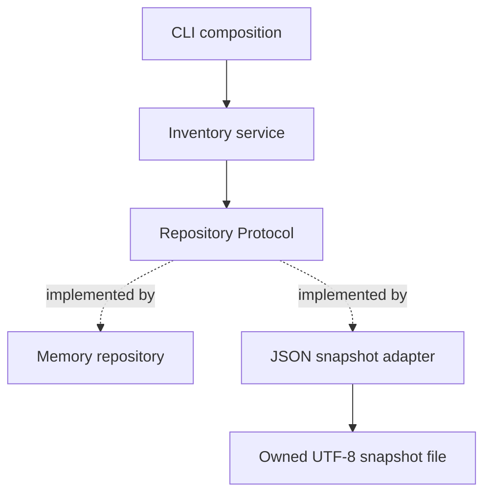

# Phase 1 project — FulfillHub inventory package

Build a pure-Python domain package before adding FastAPI or a database. This is
the first stage of [FulfillHub's course evolution](../course-plan.md#6-evolving-production-backend-project).

## Requirements

- Model a product with tenant, SKU and non-negative integer stock. Reject bool as
  a quantity/stock even though bool subclasses int.
- Provide `reserve(tenant, sku, *, quantity)` with positive integer quantities.
- Raise specific errors for unknown products and insufficient stock.
- Preserve the original value when producing updated stock. Failed operations
  leave stored state unchanged.
- Key products by tenant plus SKU, keeping independent catalogs distinct.
- Use a service with a repository Protocol; implement memory and JSON snapshots.
- Validate decoded JSON as runtime data before constructing domain values.
- Provide a package entry point, strict source typing, lint/format configuration,
  dependency lockfile, and pytest tests with isolated fixtures.

## Architecture and ownership



The service owns reservation rules; adapters own persistence. Frozen products with
primitive fields can be shared as values. A JSON write prepares a new snapshot,
replaces the file and then switches memory. The reference uses a fixed temporary
filename for a single writer; it does not support multiple writers or guarantee
crash durability. Tenant keys are a domain lookup distinction, not authorization.

## Implement in small steps

1. Write success and failure cases for product construction and reservation.
2. Implement immutable domain values and the memory repository.
3. Type the interface; make the service depend on it rather than a concrete adapter.
4. Add JSON loading with explicit shape validation and exception chaining.
5. Parametrize the contract over both adapters. Add a failed-write regression test.
6. Add package metadata, locked tools, a CLI demo, and execution instructions.

Reference files are in `examples/python-backend-engineering/src/fulfillhub/`:
`inventory.py`, `storage.py`, `__main__.py`. Attempt the design first, then compare.

## Run the reference

From `examples/python-backend-engineering/`:

```bash
uv python install 3.14
uv sync --frozen
uv run --frozen python -m fulfillhub
uv run --frozen pytest tests/test_inventory.py tests/test_semantics.py
uv run --frozen mypy
uv run --frozen ruff check .
uv run --frozen ruff format --check .
```

The demo prints `before` stock 3 and `after` stock 1. The original Product remains
unchanged. Tests use temporary files and require no cleanup; the demo writes no
persistent data.

## Acceptance matrix

| Scenario | Expected behavior |
| --- | --- |
| Reserve two of three | Return stock one; original Product still has three |
| Reserve all stock | Stock zero with empty status |
| Reserve more than available | InsufficientStock; state unchanged |
| Zero/negative/bool quantity | ValueError; state unchanged |
| Unknown tenant/SKU | UnknownSku with chained lookup cause |
| Same SKU in two tenants | Only selected tenant changes |
| Malformed or incorrectly typed JSON | Explicit rejection, not coerced valid data |
| Reopen valid snapshot | Updated stock survives reloading |
| File replacement failure | Original memory/file remain valid; temporary file cleaned |

## Design review

The [CSV reporting walkthrough](module-1/worked-examples.md#worked-lab-a-validated-inventory-csv-report)
adds a streaming, read-only report alongside this project. It deliberately does
not mutate repository stock. The [typed design review](module-2/design-and-testing.md)
explains the package's boundary and failure-test choices in detail.

Explain shallow vs deep immutability, why a Protocol helps adapters, what atomic
replacement does and does not guarantee, and why concurrent overselling is not
solved by these single-process operations. Database transactions and authenticated
tenant isolation are later-phase requirements, not hidden claims of this project.

Deliver source, tests, passing tool output, and a short decision note. Assess using
[Module 2's rubric](module-2/practice.md#mastery-assessment), then log evidence in
[progress](../progress.md).

[Phase 1 overview](index.md) · [Next project](../phase-2/project.md)
