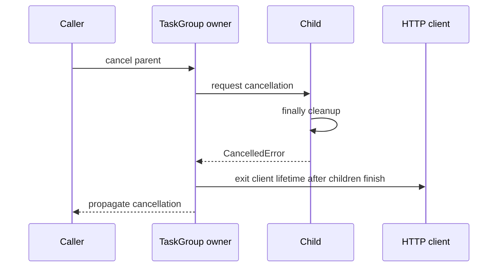

# Phase 2 — Runtime and concurrency debugging playbook

Use this as an investigation aid after the lessons. A symptom suggests a hypothesis;
it does not prove the cause. Keep each experiment small enough that the result
can disprove your current explanation.

## Start with an observation and a boundary

Record the actual interpreter/build, failing command, input size, expected behavior,
observed behavior and relevant resource limits. Separate these questions:

1. Is the result incorrect, or is the correct result taking too long?
2. Is work running, waiting on I/O, queued for a resource, or blocked on a lock?
3. Is memory temporarily allocated, still owned, or released to an allocator that
   has not returned it to the OS?
4. Which caller owns cancellation, cleanup and retry policy?

Avoid changing worker counts, GC settings, timeouts and algorithms simultaneously.
You need to know which hypothesis a retry tests.

## Symptom-to-experiment map

| Symptom | Candidate causes | First useful experiment | Misleading shortcut |
| --- | --- | --- | --- |
| RSS rises after batches | Live caches/results, native allocations, allocator retention | Compare retained traced allocations and long-lived owners across equivalent batches | Assume every rise is a cyclic-GC leak |
| One request pauses unrelated tasks | Blocking call or CPU work on the loop | Run a heartbeat and inspect slow call paths | Add more coroutines |
| Low CPU with high tail latency | Remote wait, pool exhaustion, locks, queue backlog | Separate queue/pool/connect/read durations | Conclude the machine needs more CPU |
| Completed count is too low | Read/await/write race, partial failure | Barrier-controlled reproduction and per-task outcomes | Assume the GIL protects the invariant |
| Shutdown hangs | Unowned tasks, swallowed cancellation, non-stopping threads | Trace task owners and finally blocks | Call cancel repeatedly without awaiting cleanup |
| Descriptor validation seems ignored | Private storage edited, wrong attribute owner, override | Inspect class descriptor and instance keys separately | Assume properties are security controls |
| Method called twice or skipped | Mixed direct base calls and cooperative super | Print MRO and a short call trace | Guess from the textual base class list alone |
| Benchmark suddenly improves | Different output, cache effects, setup excluded, input drift | Verify equivalent work and repeat under controlled conditions | Publish the fastest single run |

## Runbook — Retained memory

1. Choose a bounded, repeatable operation and measure before/after several runs.
2. Inspect Python allocation traces, keeping instrumentation overhead separate
   from the performance timing you eventually compare.
3. Look for references held by caches, closures, results, exception tracebacks,
   unfinished generators and tasks.
4. Release/bound one suspected owner and rerun the same workload.
5. If Python traces do not explain process memory, investigate native allocations
   and allocator behavior rather than inventing a refcount explanation.

Do not run `gc.collect()` in every request as a universal fix. An application still
holding an object is asking the collector to keep it. Closing a file/socket and
reclaiming the Python object representing it are separate lifecycle events.

## Runbook — An overloaded aggregator

Write down worker count W, queue capacity Q, connection count C, average and tail
operation durations, input count and maximum body size. Then follow the buffers:

```text
caller input → producer → pending queue → workers → pool → response bodies → results
```

A bounded middle queue does not bound caller input or retained output. If W greatly
exceeds C, workers can spend time waiting for the pool. If C exceeds downstream
capacity, more connections can increase latency and errors. Align limits with an
observed budget and test overload behavior explicitly.

Decide what happens when admission cannot keep up: wait with a deadline, reject
new work, return a defined partial result, or stream results under backpressure.
“Just queue it” defers the capacity problem and can make memory the failure mode.

## Runbook — Cancellation and cleanup

Use events to prove work started before cancellation. In the test, retain the
parent task, wait for the child's entered signal, call `cancel()`, await the parent,
and check the child's finally/closed-resource evidence. Do not confuse “no longer
awaited” with “no longer executing.”



A thread doing blocking work may continue after its async wrapper is cancelled.
Underlying operation timeouts, cooperative stop signals and bounded executor
shutdown need their own policy. `shield()` may keep work alive but does not tell
you who will await it or how long cleanup is allowed to take.

## Runbook — A race or deadlock

For a race, mark every read, suspension, write and owner in a timeline. Use a barrier
to reproduce the offending ordering. Choose synchronization with the same scope as
the state: async tasks, threads, processes or database transactions are not one
interchangeable domain.

For a suspected deadlock, draw which task holds each resource and which resource
it waits for. Look for opposite lock ordering, re-entering a non-reentrant lock,
or holding a lock while awaiting work that needs that same lock. A bigger timeout
does not resolve circular waiting. Prefer consistent acquisition order and smaller
critical sections, or redesign toward one state owner.

## What a convincing measurement report contains

- Question and hypothesis, including what observation would disprove it.
- Runtime/build, OS and available CPU/memory context.
- Equivalent input/output semantics, scale and hit/error distribution.
- Repeated baseline/candidate durations, setup inclusion and instrumentation policy.
- Memory interpretation: incremental traced allocation vs total process memory.
- Change chosen, behavior tests, and the workload where the conclusion may not hold.

Use `performance_lab` as a starting point, not a production capacity benchmark.
Use `cProfile` to investigate CPU paths, not to measure remote-service guarantees.
With `timeit`, distinguish building an index on every call from reusing an index
whose memory and invalidation policy are part of the service.

## Commands for the first two phases

From `examples/python-backend-engineering/`:

```bash
uv run --frozen python -m fulfillhub.runtime_lab
uv run --frozen python -m fulfillhub.object_model
uv run --frozen python -m fulfillhub.performance_lab
uv run --frozen python -m fulfillhub.async_patterns
uv run --frozen python -m fulfillhub.concurrency_lab
uv run --frozen pytest tests/test_async_patterns.py tests/test_aggregation.py
```

The experiments are local and bounded. Process-pool timings and free-threaded
behavior need runtime-specific interpretation; the reference checks ordinary
CPython 3.14. The unsafe counter and blocked sleep are deliberate teaching defects,
not recommended patterns for application code.

[Runtime walkthrough](module-3/runtime-investigations.md) ·
[Concurrency walkthrough](module-4/concurrency-patterns.md) · [Assessment](assessment.md)
