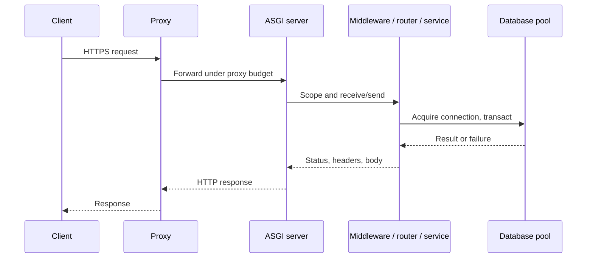

# Module 6 — Web-server architecture

**P0 · prerequisite: HTTP contracts and asyncio lifetimes**

A web application runs inside a system of network listeners, proxies, server
processes, middleware and dependency pools. Understanding the boundaries helps
explain why a correct handler can still time out, block unrelated work or fail
during deployment.

## Chapter navigation

1. [Proxies, gateways and balancing](#proxies-gateways-and-balancing)
2. [WSGI, ASGI and Uvicorn](#wsgi-asgi-and-uvicorn)
3. [Request and worker lifetimes](#request-and-worker-lifetimes)
4. [Synchronous and asynchronous execution](#synchronous-and-asynchronous-execution)
5. [Timeouts and disconnects](#timeouts-and-disconnects)
6. [Outbound connections](#outbound-connections)
7. [Error boundaries and shutdown](#error-boundaries-and-shutdown)

## Proxies, gateways and balancing

A reverse proxy accepts client traffic and forwards it to an application. It may
terminate TLS, buffer bodies, enforce size/time limits and rewrite paths. An API
gateway often adds authentication policy, routing and quotas. A load balancer
distributes traffic using connection/request policies and health observations.
These roles can overlap in one product; responsibilities matter more than labels.

Trust forwarded client/protocol headers only from configured trusted proxies.
Otherwise a caller may forge its apparent IP or HTTPS origin. Account for path
prefixes in routing, redirects and generated documentation. Decide which layer
owns compression, request identifiers, body limits and error formatting.

Balancing changes where shared state can live. A global Python dict belongs to
one worker process, not the whole service. Sticky routing can reduce movement but
does not make that state durable or provide a failover strategy.

## WSGI, ASGI and Uvicorn

WSGI defines a synchronous Python web application interface centered on an
environment and a response iterable. ASGI uses an async callable with scope,
receive and send channels; it supports HTTP, WebSocket and lifespan interactions.
ASGI is an interface, not a guarantee that every called library is nonblocking.

```python
async def app(scope, receive, send):
    if scope["type"] != "http":
        return
    await send({"type": "http.response.start", "status": 200,
                "headers": [(b"content-type", b"text/plain")]})
    await send({"type": "http.response.body", "body": b"ok"})
```

This minimal interface illustration intentionally omits lifespan, request body
handling and production behavior. Uvicorn is an ASGI server: it owns network
parsing and drives the application callable. FastAPI supplies routing/dependency
behavior above that interface. Do not call a framework, an interface and a server
the same thing during an architecture explanation.

## Request and worker lifetimes



A server process owns an event loop and application lifespan resources. Each
request owns its request-local context, and usually a database session/transaction
scope. Middleware surrounds routing and may measure or translate errors. Response
serialization and streaming can continue after the handler returns its object.

With W workers and a maximum of C database connections per process, potential
connections scale near W × C, plus overflow and other services. Worker scaling
can exhaust the database before CPU is saturated. Choose counts from memory,
CPU and dependency capacity rather than one universal worker formula.

## Synchronous and asynchronous execution

An async endpoint runs on the event loop and must cooperate at suspension points.
A synchronous endpoint can be dispatched to a framework-managed thread pool.
The exact offload rules belong to the framework: a synchronous utility function
called directly inside async code is not automatically offloaded.

Distinguish waiting on an async driver, blocking in a thread, and running CPU work.
Threads can overlap blocking I/O but have finite capacity. A full thread pool can
make sync handlers wait even while loop CPU is low. Pure Python CPU work may need
separate workers/processes rather than more coroutine tasks.

Middleware also needs scrutiny: reading/copying a large request body, synchronous
logging or CPU-heavy transformations can add latency before business code runs.
Do not repeatedly consume a body without understanding how the framework buffers
or exposes its stream.

## Timeouts and disconnects

There are budgets at the client, proxy, server, application and dependency layers.
Set them coherently so an inner operation normally terminates while the caller
can still receive a meaningful outcome. A keep-alive idle timeout is not a complete
request execution deadline.

A client disconnect does not universally cancel all application work immediately.
ASGI exposes disconnect events, but frameworks, streaming state and already-started
work affect how they are observed. Cancellation is cooperative; blocking code may
continue. A response lost after commit leaves an unknown outcome requiring the
retry/idempotency contract from Module 5.

Choose a cancellation policy for long computations and external calls. Work that
must outlive the request needs a durable acceptance/job boundary, not an unowned
background task. Database transaction cleanup must roll back failed/uncommitted
work and release its connection even if the caller vanishes.

## Outbound connections

Create a shared async HTTP client at application startup and close it on shutdown.
Its pool reuses connections and caps in-flight sockets. Apply connect/read/pool
timeouts and an overall caller budget where required. Recreating the client in
every handler discards pooling and can increase handshake and socket pressure.

Do not share one client across unrelated event loops without documented support.
Do not confuse a session cookie jar in an HTTP client with a database session.
Bound retries so a struggling dependency does not receive a multiple of the
original request load. Record which phase of the call consumed time.

## Error boundaries and shutdown

Expected domain failures can become stable application responses. Unexpected
exceptions need safe 5xx responses and internal diagnostic evidence. Once response
headers/body bytes have been sent, a streaming failure cannot retroactively become
an ordinary JSON error response; define termination/resume behavior separately.

Graceful shutdown normally stops new work, drains accepted work under a deadline,
cancels what cannot finish, closes clients/pools and exits. The load balancer's
drain timing and process termination grace period must leave room for this sequence.
Readiness withdrawal and connection closure are not instantaneous across a cluster.

## Worked failure analysis

After adding workers, p99 worsens while CPU stays low. Hypothesize pool saturation:
multiply per-worker connection limits, check database active/waiting sessions,
transaction lengths and application pool wait. Compare against thread-pool or
outbound-pool waits instead of assuming low CPU proves a healthy service. Reduce
admission/transaction time or fix the underlying query before adding more workers.

## Sources and next step

[ASGI specification](https://asgi.readthedocs.io/en/latest/),
[Uvicorn settings](https://www.uvicorn.org/settings/) and
[Starlette thread pool](https://www.starlette.io/threadpool/) document interface
and framework details. Resource lifetime behavior must be checked against the
versions chosen when the project is implemented.

[Practice](practice.md) · [Phase assessment](../assessment.md) ·
[Next: FastAPI](../../phase-4/module-7/index.md)
