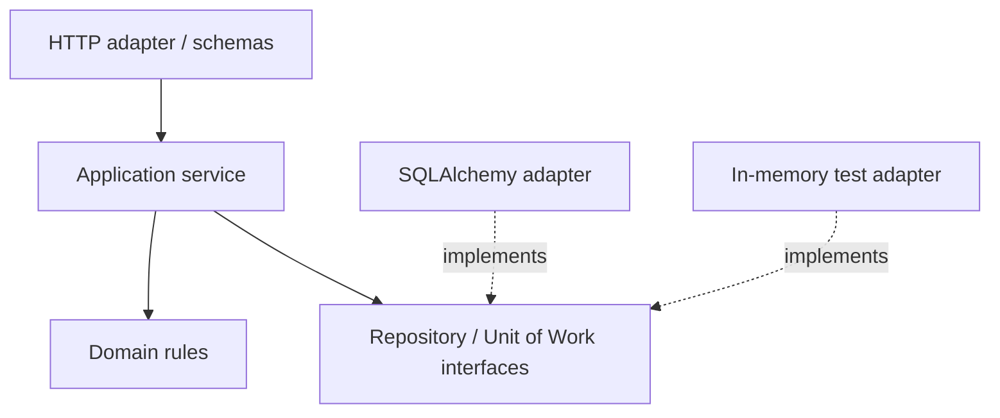

# Module 8 — Application architecture and testing

**P0 · prerequisite: typed Python, HTTP and FastAPI boundaries**

Architecture controls where decisions live and how they can change. For FulfillHub,
stock rules should survive a transport or storage change, while API validation,
database mapping and external identity retain explicit owners. Tests should fail
when those contracts break and survive harmless internal refactors.

## Chapter navigation

1. [Models and dependency direction](#models-and-dependency-direction)
2. [Services, repositories and Unit of Work](#services-repositories-and-unit-of-work)
3. [Sessions and transactions](#sessions-and-transactions)
4. [Configuration and secrets](#configuration-and-secrets)
5. [Test layers and isolation](#test-layers-and-isolation)
6. [Async tests and real infrastructure](#async-tests-and-real-infrastructure)
7. [Modular monoliths and refactoring](#modular-monoliths-and-refactoring)

## Models and dependency direction

An API model describes exchanged data, a domain model describes business meaning,
and a persistence model describes stored representation/relationships. They may
start similar but have different reasons to change. Separation earns its cost
when exposure, lifecycle or invariants differ; copying every field through ten
layers without a purpose adds maintenance rather than protection.

Layered designs group responsibilities; Clean/hexagonal designs emphasize dependency
direction toward use-case/domain interfaces and replaceable adapters. These are
tools for expressing boundaries, not requirements for a specific folder diagram.
The service imports a repository Protocol, not a framework session constructor.
Composition at an entry point supplies actual adapters.



### Example — the same id has different meanings at different boundaries

An API input might contain product_id and quantity. The domain uses an authorized
tenant, a Product identity and a reservation rule. Persistence adds columns such
as lock/version state. A response exposes the new order id/status, not every
persistence field.

Mapping is worthwhile because these meanings differ. Blindly sharing one class
can let a client supply server-owned fields or make domain logic depend on a live
ORM session. Blindly creating many identical wrappers can add noise without an
actual boundary.

Ask which component owns validation, authorization, invariant enforcement,
persistence and serialization. Draw dependencies toward stable use-case/domain
interfaces. Folder names alone do not enforce that direction.

## Services, repositories and Unit of Work

A service coordinates a business use case. A repository adapts persistence/query
operations. A Unit of Work defines the transaction containing several effects.
For order placement, stock reservation, order insert and outbox insert may need
one commit boundary; each repository committing independently breaks that invariant.

Illustrative orchestration:

```python
def place_order(command, uow):
    with uow:
        product = uow.products.get_for_update(command.tenant, command.product_id)
        order = product.reserve_for(command.quantity)
        uow.orders.add(order)
        uow.events.add(order.created_event())
        uow.commit()
    return order
```

This is a conceptual interface, not executable project code. The names expose
the transaction/locking intent. An implementation must establish lock order,
failure rollback and event durability. Do not make a remote HTTP call inside the
transaction merely because it is convenient to keep one function.

Dependency inversion does not demand a DI container: constructor/function arguments
and FastAPI dependencies can compose a small application. Avoid a service locator
whose global lookups hide every required dependency.

### Example — why repositories must not commit independently

```text
reserve stock → repository A commits
insert order  → repository B fails
try rollback  → cannot undo A's already committed transaction
```

The business invariant spans both effects, so one use case must own the transaction.
Repositories perform their operations within it; the Unit of Work commits only
after all required effects succeed and rolls back failed/uncommitted work.

An outbox record may belong inside that same boundary. A vendor call usually
cannot join the database transaction, so holding locks during a slow HTTP request
does not create atomicity with the vendor. Use a supported idempotency/workflow
protocol for that separate boundary.

A dependency-injection container is optional. Explicit constructor/function
arguments can supply a repository and Unit of Work without hiding them behind
global service-locator lookups.

## Sessions and transactions

SQLAlchemy 2.x separates engines/pools from Session/AsyncSession units of interaction.
A session tracks ORM identity and changes; it is not a globally shared connection.
Use a session per unit of work/request context as appropriate, and do not share
one mutable session between concurrent tasks. An engine is commonly process-owned.

Sync and async engines/drivers expose different APIs. Choosing async affects the
entire I/O path and relationship-loading behavior; it does not parallelize SQL on
one session. Transaction context managers can commit on success/roll back on failure,
but the caller must choose the correct scope and close/release resources.

ORM objects can become detached or have expired attributes after commit/closure.
Returning them into later serialization can trigger unexpected I/O or errors.
Materialize a response-safe projection while its owning context is valid. Measure
queries and loading strategies rather than assuming an ORM expression executes
one efficient statement.

### Example — one session is not one safe shared query channel

Suppose two asyncio tasks share an AsyncSession. Task A begins changing an order;
task B performs an unrelated operation and commits. They now interact through
the same mutable identity/transaction state. Awaiting both concurrently does not
give each its own independent transaction.

Use a session per appropriate unit of work and avoid sharing it across concurrent
tasks. An engine/pool can be reused under its supported lifecycle; the session
has a shorter, mutable scope. Returning an ORM object after closing that scope
can cause later lazy/expired attribute access to require unavailable I/O.

Project safe response data while the required context is valid, and measure the
actual queries/loading strategy. AsyncSession does not turn every attribute read
into an automatically awaited database operation.

### Put commit before the successful response, and cleanup on every exit

The SQLAlchemy 2.x synchronous ownership pattern can look like this conceptual
excerpt; engine and stock/order statements belong to the deferred implementation:

```python
from sqlalchemy.orm import Session

def apply_order(engine, stock_statement, order_statement):
    with Session(engine) as session:
        with session.begin():
            allocated = session.execute(stock_statement).first()
            if allocated is None:
                raise ValueError("stock was not allocated")
            session.execute(order_statement)
        # The transaction context has completed successfully here.
        return {"status": "accepted"}
```

The transaction context commits on successful exit and rolls back on error; the
outer context closes the session. The stock statement here must be a guarded
UPDATE with RETURNING, so no returned row aborts the use case instead of creating
an order without allocation. The real statements must enforce tenant, quantity
and concurrency invariants. For async APIs, use the corresponding
AsyncSession/async context operations rather than sharing a mutable session
between tasks.

Reporting 200 and only later trying to commit during request cleanup risks a
client seeing success before the commit fails. Conversely, serialization/network
failure after a successful commit does not undo it. Preserve an idempotent
outcome/reconciliation policy for that uncertainty.

## Configuration and secrets

Read configuration at a clear composition boundary and validate required values
early. Separate non-secret settings from credentials. Do not embed secrets in source,
images, test snapshots or example connection strings. A secret manager/binding
provides values securely, but rotation, permissions and log redaction still need
design. Avoid printing all configuration to diagnose one missing name.

Production settings should not silently use development fallbacks. Keep test
configuration isolated from live services and make dangerous destinations difficult
to select accidentally. Connection limits/timeouts are part of configuration,
not incidental library defaults.

### Example — validate configuration at composition, not halfway through a request

A missing database destination discovered on the first checkout request produces
a user-visible failure long after deployment looked successful. Validate required
settings when composing the application and give failures enough context without
printing credential values.

Distinguish absence from an intentional empty/zero setting. Separate test and live
destinations so an integration fixture cannot silently fall back to production.
A secret manager supplies values through a secure mechanism, but permissions,
rotation/adoption and redaction remain application/platform responsibilities.

Avoid module-level configuration loading that acquires real resources merely
because a test imports a type. Startup configuration, installed dependencies and
per-request data each have different owners and failure reporting needs.

## Test layers and isolation

| Layer | What it proves | Typical limits |
| --- | --- | --- |
| Unit | Domain decisions and transformations in isolation | Does not exercise ORM/network behavior |
| Adapter integration | SQL, mappings, constraints, resource behavior | More setup and execution cost |
| Contract | Observable agreement between implementations/callers | Only as strong as the selected cases |
| End-to-end | A complete representative path across deployed boundaries | Harder diagnosis and higher variability |

Test invalid and forbidden behavior, not just success. Assert state after a failure,
not only an exception. Use fresh data/transaction isolation and deterministic time
where relevant. A session-scoped mutable fixture can leak state across tests;
parallel runners need independent databases/schemas or another explicit isolation policy.

Mock a nondeterministic boundary to inject a failure; do not mock every internal
method and assert the existing call sequence. A test that passes when all business
logic is replaced with a stub is not evidence of business correctness.

### Example — ask what defect would make each test fail

For a rejected reservation, a unit test can assert unchanged domain state. For
PostgreSQL rollback, an integration test must cross the real transaction boundary.
For a public error schema, a route contract test can submit an invalid request.
For TLS/proxy behavior, an in-process route call is insufficient.

If every repository call is mocked, a test may verify the existing call sequence
while missing a real independent commit or wrong SQL predicate. Keep assertions
about observable guarantees, then choose the lowest test layer able to expose
the defect.

Fixtures need isolated data and controlled lifetime. Sharing one mutable session
between tests can hide missing setup or create order-dependent results. Parallel
workers need an explicit data-isolation strategy too.

## Async tests and real infrastructure

HTTPX ASGI transport can exercise application requests without a real TCP listener.
That makes route tests fast but does not validate DNS, TLS, proxy configuration or
socket-level timeouts. Lifespan handling may require explicit management in the
chosen test tooling; do not assume every client automatically runs startup/shutdown.

Use pytest with an appropriate async test plugin/backend and scoped fixtures.
Control dependency overrides and reset them after each test. Separate verifier
tests from route tests that replace authentication.

Testcontainers or ephemeral Docker services can provide disposable PostgreSQL and
other dependencies. Pin versions, wait for functional readiness, migrate and clean
data. SQLite is useful for some local tests but is not equivalent to PostgreSQL
locking, JSONB, indexes or isolation. Test actual PostgreSQL semantics where those
semantics are the requirement. Here the project and its environment remain deferred.

### Example — a passing ASGI request does not prove a deployment works

HTTPX's ASGI transport can invoke an application without DNS, sockets, TLS or a
reverse proxy. That is useful for fast route behavior checks. It cannot detect
a wrong container bind address, an ingress path-prefix error or certificate failure.

Startup/lifespan may also need explicit management in the chosen test tools.
A route that only works because a fixture supplied a client is not evidence its
real application startup creates/closes that client.

Use real PostgreSQL for behavior depending on its locks/isolation/types. SQLite
may cover some application paths, but passing it cannot establish PostgreSQL
concurrency correctness. The practical service environment remains deferred;
these are test-design examples, not executed infrastructure claims.

## Modular monoliths and refactoring

A modular monolith can enforce capability boundaries without cross-service network
costs. Keep modules from reaching into each other's internal tables/types casually.
Expose explicit use-case/query interfaces and record dependency direction.

Refactor in small steps behind existing observable behavior: characterize public
contracts, introduce a seam, move one responsibility, then rerun the checks relevant
to that boundary. A green unit suite with mocked SQL cannot establish a persistence
refactor preserved real transaction behavior. Compare schemas/OpenAPI and important
queries as well as function results.

### Example — refactor one boundary while protecting the public contract

Start with a large handler that parses input, selects SQL, changes state and
constructs a response. First capture important success/error/authorization behavior.
Then extract one application operation with explicit inputs/dependencies, retaining
the same observable responses.

Next separate persistence behind a meaningful interface and verify real transaction
behavior where required. Compare OpenAPI/exposure and query behavior as well as
returned values. A refactor can preserve a happy response while introducing N+1
queries or closing a stream's session early.

A modular monolith supports these steps without adding network calls or deploying
new services. Choose extraction only when its independence or scaling benefit
earns the data ownership, failure and operating cost.

## Worked failure analysis

An order row exists but inventory was not reserved. Identify whether repositories
commit separately or error handling swallowed the second failure. Define the
business invariant, place effects inside one Unit of Work and test a failure between
effects using a real transaction boundary. Rolling back a later session cannot
undo an earlier repository's committed write.

[SQLAlchemy session basics](https://docs.sqlalchemy.org/en/20/orm/session_basics.html),
[async sessions](https://docs.sqlalchemy.org/en/20/orm/extensions/asyncio.html) and
[Cosmic Python](https://www.cosmicpython.com/book/part1.html) provide deeper treatment.

[Practice](practice.md) · [Phase assessment](../assessment.md) ·
[Next: relational modeling](../../phase-5/module-9/index.md)
