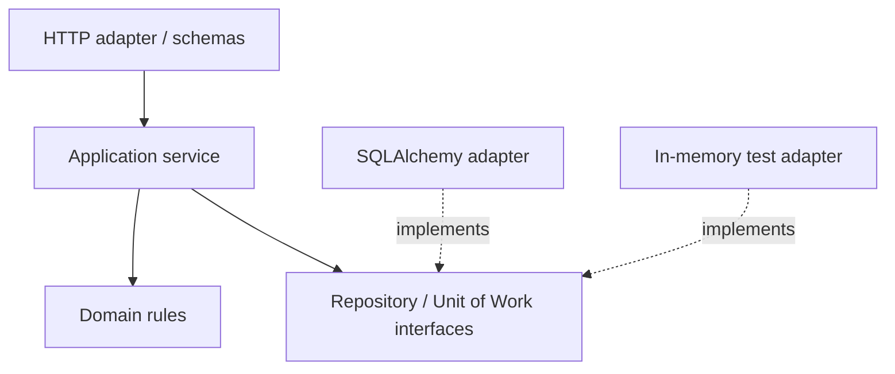

# Module 8 — Application architecture and testing

**P0 · prerequisite: typed Python, HTTP and FastAPI boundaries**

Architecture controls where decisions live and how they can change. For FulfillHub,
stock rules should survive a transport or storage change, while API validation,
database mapping and external identity retain explicit owners. Tests should fail
when those contracts break and survive harmless internal refactors.

## Chapter navigation

1. [Models and dependency direction](#models-and-dependency-direction)
2. [Services, repositories and Unit of Work](#services-repositories-and-unit-of-work)
3. [Sessions and transactions](#sessions-and-transactions)
4. [Configuration and secrets](#configuration-and-secrets)
5. [Test layers and isolation](#test-layers-and-isolation)
6. [Async tests and real infrastructure](#async-tests-and-real-infrastructure)
7. [Modular monoliths and refactoring](#modular-monoliths-and-refactoring)

## Models and dependency direction

An API model describes exchanged data, a domain model describes business meaning,
and a persistence model describes stored representation/relationships. They may
start similar but have different reasons to change. Separation earns its cost
when exposure, lifecycle or invariants differ; copying every field through ten
layers without a purpose adds maintenance rather than protection.

Layered designs group responsibilities; Clean/hexagonal designs emphasize dependency
direction toward use-case/domain interfaces and replaceable adapters. These are
tools for expressing boundaries, not requirements for a specific folder diagram.
The service imports a repository Protocol, not a framework session constructor.
Composition at an entry point supplies actual adapters.



## Services, repositories and Unit of Work

A service coordinates a business use case. A repository adapts persistence/query
operations. A Unit of Work defines the transaction containing several effects.
For order placement, stock reservation, order insert and outbox insert may need
one commit boundary; each repository committing independently breaks that invariant.

Illustrative orchestration:

```python
def place_order(command, uow):
    with uow:
        product = uow.products.get_for_update(command.tenant, command.product_id)
        order = product.reserve_for(command.quantity)
        uow.orders.add(order)
        uow.events.add(order.created_event())
        uow.commit()
    return order
```

This is a conceptual interface, not executable project code. The names expose
the transaction/locking intent. An implementation must establish lock order,
failure rollback and event durability. Do not make a remote HTTP call inside the
transaction merely because it is convenient to keep one function.

Dependency inversion does not demand a DI container: constructor/function arguments
and FastAPI dependencies can compose a small application. Avoid a service locator
whose global lookups hide every required dependency.

## Sessions and transactions

SQLAlchemy 2.x separates engines/pools from Session/AsyncSession units of interaction.
A session tracks ORM identity and changes; it is not a globally shared connection.
Use a session per unit of work/request context as appropriate, and do not share
one mutable session between concurrent tasks. An engine is commonly process-owned.

Sync and async engines/drivers expose different APIs. Choosing async affects the
entire I/O path and relationship-loading behavior; it does not parallelize SQL on
one session. Transaction context managers can commit on success/roll back on failure,
but the caller must choose the correct scope and close/release resources.

ORM objects can become detached or have expired attributes after commit/closure.
Returning them into later serialization can trigger unexpected I/O or errors.
Materialize a response-safe projection while its owning context is valid. Measure
queries and loading strategies rather than assuming an ORM expression executes
one efficient statement.

## Configuration and secrets

Read configuration at a clear composition boundary and validate required values
early. Separate non-secret settings from credentials. Do not embed secrets in source,
images, test snapshots or example connection strings. A secret manager/binding
provides values securely, but rotation, permissions and log redaction still need
design. Avoid printing all configuration to diagnose one missing name.

Production settings should not silently use development fallbacks. Keep test
configuration isolated from live services and make dangerous destinations difficult
to select accidentally. Connection limits/timeouts are part of configuration,
not incidental library defaults.

## Test layers and isolation

| Layer | What it proves | Typical limits |
| --- | --- | --- |
| Unit | Domain decisions and transformations in isolation | Does not exercise ORM/network behavior |
| Adapter integration | SQL, mappings, constraints, resource behavior | More setup and execution cost |
| Contract | Observable agreement between implementations/callers | Only as strong as the selected cases |
| End-to-end | A complete representative path across deployed boundaries | Harder diagnosis and higher variability |

Test invalid and forbidden behavior, not just success. Assert state after a failure,
not only an exception. Use fresh data/transaction isolation and deterministic time
where relevant. A session-scoped mutable fixture can leak state across tests;
parallel runners need independent databases/schemas or another explicit isolation policy.

Mock a nondeterministic boundary to inject a failure; do not mock every internal
method and assert the existing call sequence. A test that passes when all business
logic is replaced with a stub is not evidence of business correctness.

## Async tests and real infrastructure

HTTPX ASGI transport can exercise application requests without a real TCP listener.
That makes route tests fast but does not validate DNS, TLS, proxy configuration or
socket-level timeouts. Lifespan handling may require explicit management in the
chosen test tooling; do not assume every client automatically runs startup/shutdown.

Use pytest with an appropriate async test plugin/backend and scoped fixtures.
Control dependency overrides and reset them after each test. Separate verifier
tests from route tests that replace authentication.

Testcontainers or ephemeral Docker services can provide disposable PostgreSQL and
other dependencies. Pin versions, wait for functional readiness, migrate and clean
data. SQLite is useful for some local tests but is not equivalent to PostgreSQL
locking, JSONB, indexes or isolation. Test actual PostgreSQL semantics where those
semantics are the requirement. Here the project and its environment remain deferred.

## Modular monoliths and refactoring

A modular monolith can enforce capability boundaries without cross-service network
costs. Keep modules from reaching into each other's internal tables/types casually.
Expose explicit use-case/query interfaces and record dependency direction.

Refactor in small steps behind existing observable behavior: characterize public
contracts, introduce a seam, move one responsibility, then rerun the checks relevant
to that boundary. A green unit suite with mocked SQL cannot establish a persistence
refactor preserved real transaction behavior. Compare schemas/OpenAPI and important
queries as well as function results.

## Worked failure analysis

An order row exists but inventory was not reserved. Identify whether repositories
commit separately or error handling swallowed the second failure. Define the
business invariant, place effects inside one Unit of Work and test a failure between
effects using a real transaction boundary. Rolling back a later session cannot
undo an earlier repository's committed write.

[SQLAlchemy session basics](https://docs.sqlalchemy.org/en/20/orm/session_basics.html),
[async sessions](https://docs.sqlalchemy.org/en/20/orm/extensions/asyncio.html) and
[Cosmic Python](https://www.cosmicpython.com/book/part1.html) provide deeper treatment.

[Practice](practice.md) · [Phase assessment](../assessment.md) ·
[Next: relational modeling](../../phase-5/module-9/index.md)
