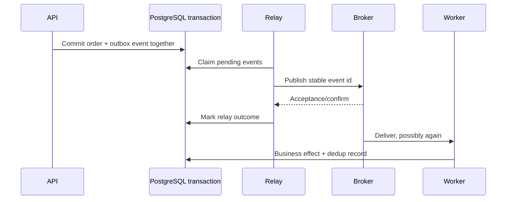

# Module 12 — Messaging and distributed workflows

**P0/P1 · prerequisite: transactions, idempotency and resource limits**

Messaging decouples when producers and consumers run. It introduces retained work,
delivery acknowledgements, duplicates and partial failures. A reliable design
explains every crash point between committing business state and acknowledging
the work—not just the successful publish call.

## Chapter navigation

1. [Queues, logs and broker choice](#queues-logs-and-broker-choice)
2. [Workers and delivery semantics](#workers-and-delivery-semantics)
3. [Idempotent consumers](#idempotent-consumers)
4. [Retries and dead letters](#retries-and-dead-letters)
5. [Transactional outbox](#transactional-outbox)
6. [Sagas and compensation](#sagas-and-compensation)
7. [Resilience and CAP](#resilience-and-cap)

## Queues, logs and broker choice

A work queue distributes jobs among consumers; a retained event log supports
ordered partition history and replay; Pub/Sub describes distribution to subscribers
with durability depending on the implementation. An event records a fact; a command
requests work. Confusing them obscures ownership and retry semantics.

| Tool | Typical fit | Questions to answer |
| --- | --- | --- |
| RabbitMQ | Routed work queues and acknowledgement-driven workers | Queue type/durability, confirms, prefetch, redelivery and operations |
| Kafka | Partitioned retained event streams and replay | Partition key/order, offsets, retention, rebalancing and consumer lag |
| SQS | Managed queued work | Visibility, redelivery, DLQ, throughput and Standard/FIFO semantics |

Ordering is scoped: Kafka partitions, queue configuration and SQS mode have distinct
contracts. Global order can restrict throughput. Choose based on workload, recovery,
operations and cost, not product popularity. Broker “exactly once” features have
defined scopes and do not magically cover an external email/payment side effect.

## Workers and delivery semantics

Celery or another worker framework handles task dispatch/execution, but acknowledgement,
retry and result settings affect crash behavior. Ack-before-processing can lose
work after a crash; ack-after-processing permits duplicates if the worker commits
then crashes before acknowledgement. SQS visibility expiry makes a message
eligible for redelivery and may require controlled extension for long work.

At-most-once avoids redelivery at the cost of possible loss; at-least-once accepts
redelivery and requires safe effects. Prefetch and worker concurrency bound in-flight
work. Unbounded or overly large reservations can make recovery slow and unfair.
Define poison-message handling and graceful worker shutdown.

## Idempotent consumers

For a database-local effect, persist a processed-event identity and the business
change in one transaction. A unique constraint serializes duplicate claims:

```text
begin transaction
    insert (consumer, event_id) into processed_events under a unique constraint
    if already processed: no new business effect
    otherwise: apply domain change
commit
acknowledge message
```

The duplicate path must correctly handle the database's conflict/transaction
behavior. A check-then-insert without uniqueness is a race. Retention must cover
the redelivery/replay window, and identifiers must be stable across retries.

If the effect is external, the local processed flag cannot atomically commit the
remote effect. Use the provider's idempotency/reconciliation contract or a durable
state machine. Marking processed before a call risks loss; after it risks duplicates.
State this gap instead of claiming end-to-end exactly once.

## Retries and dead letters

Classify transient vs permanent errors. Apply bounded exponential backoff, jitter,
attempt/deadline budgets and capacity limits. Several layers each retrying three
times can multiply load; choose an owner for retries. Retryable transactions and
retryable messages operate at different scopes.

A dead-letter queue retains work needing diagnosis/action. Include safe metadata,
error classification and attempt history; define ownership, alerting, retention,
redrive conditions and duplicate behavior. It is not a place to hide silently lost
business requests. A poison schema error will not improve after infinite retries.

## Transactional outbox

The dual-write gap occurs when an order commits but publish fails—or publish
succeeds while the order rolls back. Store order and outbox row atomically, then
let a relay publish retained intent. The relay may publish twice if it crashes
after broker acceptance and before marking the row delivered.



Polling or change-data-capture relays have different operational costs. Claiming,
ordering, batching and retention need design. Outbox fixes the database/publish
intent gap under its assumptions; it does not remove duplicate delivery or guarantee
global order across independent aggregates.

## Sagas and compensation

A saga coordinates local transactions across capabilities with durable progress
and compensating actions. Compensation is a business action, not time travel:
refunds may have fees and sent email cannot be unsent. Define timeouts, duplicate
steps, compensation failure and human reconciliation.

Orchestration centralizes workflow state; choreography distributes reactions and
can make dependencies harder to see. Prefer one local transaction when one database
and bounded use case already suffice. Advanced sagas are selected P2 implementation
work; understanding the partial-failure model comes first.

## Resilience and CAP

Timeouts bound waiting; circuit breakers reduce repeated calls to an unhealthy
dependency; bulkheads isolate resource budgets; backpressure limits admitted work.
These mechanisms need recovery/probe policies and observability. A breaker opening
does not determine whether the business should queue, degrade or reject.

CAP concerns the inability to guarantee both linearizable consistency and the
formal availability property during a network partition. It is not a three-item
shopping list or proof one product is always “AP.” State the operation, partition
and consistency requirement. Normal-operation latency/consistency tradeoffs and
high availability add further design considerations.

## Worked failure analysis

A worker sends two notifications after a crash. Identify broker delivery, database
effect and external-call boundaries. Keep stable event identities, atomically
deduplicate database effects and use a provider idempotency/reconciliation strategy
for external ones. Acknowledging earlier reduces duplicates by accepting loss;
it is a different business contract, not a free fix.

[RabbitMQ reliability](https://www.rabbitmq.com/docs/reliability),
[Kafka design](https://kafka.apache.org/documentation/),
[SQS](https://docs.aws.amazon.com/AWSSimpleQueueService/latest/SQSDeveloperGuide/welcome.html)
and [Celery](https://docs.celeryq.dev/en/stable/) are the references.

[Practice](practice.md) · [Phase review](../assessment.md) ·
[Next: security](../../phase-7/module-13/index.md)
