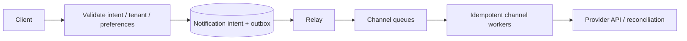
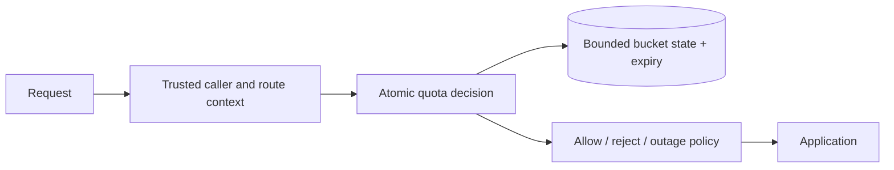
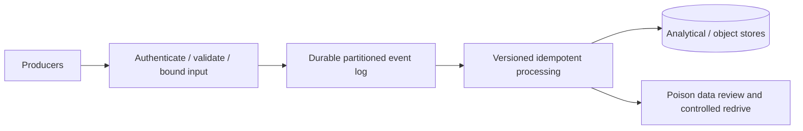

# Module 18 — Eight system-design studies

These are worked reasoning guides with hypothetical scale assumptions, not
production measurements or implemented projects. Before reading a guide, state
your own requirements and show how different assumptions would change the design.

## Shared review contract

For every study cover functional/nonfunctional requirements, capacity assumptions,
API, data model, architecture, bottleneck, failure recovery and tradeoffs. Include
tenant/security boundaries, telemetry and one evolution step. Use
[the module's capacity method](index.md#requirements-and-capacity), then attempt
the [practice prompts](practice.md) without copying the baseline.

## 1. URL shortener

**Requirements and scale:** create links, redirect, expire/disable links and prevent
abuse. Assume 100 million retained links, 1 million new links/day and 1,000 peak
redirects/second; the workload is read-heavy. Define latency and takedown freshness.

**API/model:** POST `/links` returns a code; GET `/{code}` redirects; authorized
management changes state. Store code, destination, owner/tenant, creation/expiry,
status and version. Generate random codes with a uniqueness constraint and retry
collision, or encode allocated ids under an explicit enumeration policy.

**Architecture:** API + authoritative mapping store + bounded redirect cache;
edge caching is optional under invalidation/security rules. Validate destinations
and control malicious creation. Do not confuse a public redirect with server-side
URL fetching: an automated preview fetch creates an additional SSRF boundary.

**Bottleneck/recovery:** one viral code becomes a hot key. Replicate/cache permitted
reads, bound fallback after cache failure and retain mapping backups. A takedown
must invalidate/expire cached results within the promised window. Permanent vs
temporary redirect statuses affect client caching and future destination changes.

**Tradeoff:** stronger immediate takedown conflicts with aggressive edge caching;
random codes reduce obvious enumeration but do not replace management authorization.

## 2. Notification service

**Requirements and scale:** accept email/push/SMS intent, apply user preferences
and track outcomes. Assume 10 million intents/day with ten-times bursts, mixed
priorities and provider quotas. Define accepted durability and delivery objectives.

**API/model:** POST `/notifications` with idempotency key; GET status. Store stable
intent id, tenant, recipient reference, channel/template version, consent/preference
decision and attempts. Avoid copying sensitive content into every telemetry record.

**Architecture:** durable intent/outbox, channel queues and idempotent workers,
provider adapters and rate budgets. Queue acceptance is not proof a person received
the message. Define which provider states count as delivery for the contract.

**Bottleneck/recovery:** provider throttling grows lag. Bound retries, prioritize,
use circuit breaking and owned DLQs. Reconcile unknown provider outcomes using its
idempotency/status API where supported. A local processed flag cannot atomically
cover arbitrary remote sending.

**Tradeoff:** multi-provider failover improves availability but can duplicate sends
unless unknown outcomes are handled. Global ordering across channels is expensive
and often unnecessary; order only within the required conversation/entity scope.

## 3. Distributed rate limiter

**Requirements and scale:** enforce tenant/API quotas with burst policy, safe errors
and a defined outage decision. Assume 50,000 decisions/second and a few hot tenants.

**API/model:** internal decision request carries trusted subject, route class,
cost and policy version; response includes allowed/retry metadata. Store bounded
window/token state with expiry and immutable policy configuration separately.

**Architecture:** gateway admission + atomic Redis/script or another suitable store.
Partition by limit scope while preserving operations that must be atomic. A
per-instance local counter is not automatically a global limit.

**Bottleneck/recovery:** hot keys and Redis unavailability. Consider local allowance
budgets or approximations only with a stated overshoot bound. Decide fail-open
vs fail-closed by operation risk; authentication abuse and catalogue reads may differ.

**Tradeoff:** exact global limits increase coordination cost/latency. Token buckets
allow controlled bursts; fixed windows can burst at boundaries. A concurrency
semaphore cannot substitute for time-based quota semantics.

## 4. Event ingestion

**Requirements and scale:** accept validated events, durably acknowledge, replay
and expose processing status. Assume 100,000 peak events/second at 1 KB each: about
100 MB/second raw ingress before protocol/replication overhead.

**API/model:** POST batch with tenant, schema version and event identities; define
partial batch rejection explicitly. Retain accepted id, event time, ingest time,
partition key and raw/normalized payload under retention policy.

**Architecture:** authenticated bounded ingress → partitioned retained log →
validated processing → analytical/object stores. Acknowledgement must occur after
the chosen durable acceptance point. Schema registry/governance is a decision,
not a reason to trust arbitrary payloads.

**Bottleneck/recovery:** skewed partition keys, broker quota and lag. Bound batch/body
size, backpressure before accepting more work, and replay with idempotent sinks.
Handle poison schemas through quarantine and an owned correction/redrive process.

**Tradeoff:** ordering per entity improves local reasoning but limits parallelism
for hot entities. Retention enables replay at storage/operating cost; replay must
not blindly repeat external side effects.

## 5. Order processing

**Requirements and scale:** tenant-safe checkout, stock invariants, retries and
notifications. Assume 1,000 peak checkouts/second with skewed popular products;
correctness matters more than displaying perfectly fresh catalogue stock.

**API/model:** POST order with scoped idempotency key; GET tenant order. Store
order/items, reservations, inventory version/quantity, outbox and processed ids.
Define state transitions and who owns cancellation/expiry.

**Architecture:** transactional stock/order/outbox in PostgreSQL; derived catalogue
cache; relay/broker; duplicate-safe downstream workers. Payment integration needs
provider idempotency/reconciliation or a durable workflow with compensation.

**Bottleneck/recovery:** hot inventory rows and unknown commit/payment outcomes.
Choose guarded updates/locking/versioning or suitable Serializable boundaries;
bound complete retries. Reconcile durable request identities instead of creating
a second order after a timeout.

**Tradeoff:** splitting order/inventory into services creates a distributed invariant
problem. A modular monolith can be the stronger initial design; cached stock must
never authorize a reservation by itself.

## 6. Real-time messaging

**Requirements and scale:** send/history, offline catch-up and conversation ordering.
Assume 100,000 concurrent connections and 10,000 peak messages/second. Define
accepted, delivered-to-device and read receipts separately.

**API/model:** authenticated WebSocket/session protocol plus history endpoint.
Store conversation membership, stable message id, per-conversation order/sequence,
content, retention and device read/delivery positions.

**Architecture:** connection gateways + durable message write/log + fan-out workers
and online-session routing. Offline clients resume from durable history; presence
can be ephemeral with a different loss contract.

**Bottleneck/recovery:** hot groups, slow recipients and connection storms. Bound
per-client buffers, disconnect/resume slow clients and rate-limit reconnects.
Deduplicate retries and prevent unauthorized conversation/history access.

**Tradeoff:** strict global message order is rarely needed; per-conversation order
still requires coordination. End-to-end encryption changes server search/moderation
capabilities and belongs in requirements before the storage model is selected.

## 7. Document search and RAG

**Requirements and scale:** tenant-aware upload, indexing, authorized retrieval and
cited answers. Assume 1 million documents with variable size, 100 queries/second
and asynchronous indexing. Define deletion/freshness and model cost limits.

**API/model:** document ingestion/status/delete and search/query contracts. Store
tenant/ACL, source version, chunks, embedding/model version, index status and
lineage. Distinguish authoritative source from derived text/vector indexes.

**Architecture:** object storage → bounded extraction/chunking/embedding workers →
keyword/vector index → authorized retrieval → optional rerank/generation. Enforce
tenant/ACL filtering before unauthorized material can reach generation, and protect
source content/model credentials.

**Bottleneck/recovery:** model/provider quotas, large files and index lag. Retry
versioned idempotent indexing, reconcile deletions, retain rebuild lineage and
meter per-tenant cost. Treat retrieved content as untrusted input; prompt injection
must not grant tool/data privileges.

**Tradeoff:** recall, latency, freshness, model cost and answer quality compete.
Citations are useful evidence links, not proof an answer is correct. This remains
an optional later specialization in the overall course, not a required implemented app.

## 8. Multi-tenant SaaS

**Requirements and scale:** organization isolation, membership/roles, billing,
auditing and noisy-neighbor control. Assume 10,000 tenants with several very large
ones. State contractual isolation, residency and recovery requirements.

**API/model:** tenant-scoped capability APIs with trusted principal context; store
tenant, membership, entitlements and domain identities with scoped keys/constraints.
Define admin support access and audit policy separately from normal user access.

**Architecture:** start with shared application and explicit tenant-aware data
access; choose shared tables, schemas, dedicated databases or a hybrid from
isolation/operations needs. Carry tenant scope through caches, events and search.

**Bottleneck/recovery:** hot tenants dominate shared pools. Apply quotas/admission,
fairness and possibly dedicated placement. Restore/export/delete per tenant under
an explicit policy; database-wide backup alone may not meet per-tenant recovery needs.

**Tradeoff:** stronger physical isolation increases cost and migration/operations
work. Shared tables reduce overhead but demand disciplined authorization, constraints
and negative tests. Changing a tenant header must never change caller authority.

[Module 18](index.md) · [Practice](practice.md) · [Phase assessment](../assessment.md)
