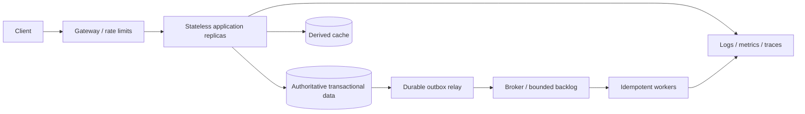

# Module 18 — Distributed system design

**P1/P2 · prerequisite: all earlier failure and ownership boundaries**

System design translates requirements into capacity, data and failure contracts.
Start with the user-visible behavior and estimates, build a simple adequate
architecture, then identify bottlenecks and justify complexity. A diagram cannot
substitute for explaining what happens when one arrow fails.

## Chapter navigation

1. [Requirements and capacity](#requirements-and-capacity)
2. [Scaling and bottlenecks](#scaling-and-bottlenecks)
3. [Replication and sharding](#replication-and-sharding)
4. [Hashing and hotspots](#hashing-and-hotspots)
5. [Consistency, availability and durability](#consistency-availability-and-durability)
6. [Disaster recovery](#disaster-recovery)
7. [Compose the whole path](#compose-the-whole-path)
8. [Optimize the right objective](#optimize-the-right-objective)

## Requirements and capacity

Separate functional behavior from latency, throughput, availability, freshness,
durability, security and cost requirements. Clarify scale, geography, tenant skew,
read/write mix and failure tolerance. Identify which numbers are facts and which
are assumptions to validate.

Ten million events/day average about 116 events/second; a ten-times peak is about
1,160/second. At one decimal kilobyte per event, raw payload is about 10 GB/day
before indexes, replication, metadata and backups. Three copies alone bring payload
storage near 30 GB/day; retention multiplies it further. State units and overhead.

If the average operation takes 200 ms at a stable 1,160/second, Little's Law suggests
roughly 232 in-system operations under matching boundaries. It does not determine
tail latency or the capacity of one database connection. Estimate hot keys, storage,
bandwidth and burst buffer size alongside average requests.

### Example — turn daily traffic into explicit units

```python
events_per_day = 10_000_000
average_per_second = events_per_day / 86_400
peak_per_second = average_per_second * 10
raw_gb_per_day = events_per_day * 1000 / 1_000_000_000
print(round(average_per_second, 1))
print(round(peak_per_second, 1))
print(raw_gb_per_day)
```

Expected output is 115.7, 1157.4, then 10.0. The payload estimate uses decimal
kilobytes/gigabytes and excludes indexes, protocol metadata, replicas and backups.
Retention and replication multiply storage.

Average rate is not a capacity target for bursty/skewed traffic. Record read/write
mix, hot tenants, peak duration and payload distribution. These are design
assumptions until measured, not proof one node supports the workload. Units and
scope make an estimate reviewable instead of decorative.

## Scaling and bottlenecks

Vertical scaling increases one machine's resources; horizontal scaling adds units
but introduces distribution/coordination. Stateless API replicas scale more easily
when authoritative state and session assumptions are externalized appropriately.
Load-balancing policies, affinity, connection lifetimes and health checks affect
actual distribution.

Find the limiting resource: CPU, memory, storage IOPS, network, connection pools,
locks, a hot partition or vendor quotas. Scaling the wrong tier can amplify queues.
Use bounded admission and backpressure; buffering buys time, not infinite throughput.
Budget end-to-end latency across serial/parallel calls and failure retries.

### Example — adding API capacity can move the queue to the database

Ten API replicas have spare CPU, while a hot stock row serializes transactions.
Adding ten more replicas does not create twenty independent copies of that
inventory invariant; it can add waiting connections and timeouts.

Identify the bottleneck and the scope of correctness. Vertical capacity may help
one resource; horizontal replication helps stateless work; an optimized transaction,
partitioning or admission policy may be the relevant change elsewhere.

For independent remote waits of 50, 80 and 100 ms, overlapping them can reduce that
portion toward the longest wait rather than their sum, plus overhead. Dependent
calls cannot be overlapped merely by creating tasks. Budget serial work, queueing
and failure retries explicitly.

## Replication and sharding

Replication copies data for availability/read capacity under defined lag/failover
semantics. Sharding partitions ownership across nodes. Choose a shard key from
access/locality/tenant distribution and future movement requirements.

Tenant-id sharding keeps local tenant operations together but a huge tenant can
dominate one shard. Hashing can spread keys but makes range queries and some joins
harder. Cross-shard transactions/queries, unique identities, resharding, routing
metadata and backup/restore now require explicit protocols.

Do not shard because the final interview diagram looks empty. Estimate the limit
of a simpler database with indexing, partitioning or read replicas first, then
state the trigger that would make data ownership distribution worthwhile.

### Example — the shard key chooses both locality and imbalance

Sharding orders by tenant keeps one tenant's queries and transactions local.
But one tenant with half the traffic can overload its shard while most nodes are
idle. Hashing every order more evenly can instead make tenant-wide operations
cross-shard.

Specify routing metadata, migration/rebalancing and backup/restore ownership.
Replication copies data; sharding divides ownership. Read replicas can help
permitted read traffic without solving a hot primary write invariant.

Do not shard to fill a diagram. First estimate a simpler database's indexed access,
partition/retention options and actual limit. State which measurement would justify
the cost of cross-shard queries, uniqueness and transactions.

## Hashing and hotspots

Consistent hashing reduces key movement when members change compared with naive
modulo placement. Virtual nodes can smooth distribution and support different
node capacities, but operational rebalancing and metadata still matter.

It does not split a single extremely hot key automatically. Hotspot remedies can
include replication, key subdivision, local caching or separate placement with
different consistency costs. Salting counters complicates exact reads and atomic
limits. A popular tenant, object or time bucket can defeat balanced average load.

### Example — rebalancing keys does not split a single hot key

Naive key modulo node-count placement can remap many keys when node count changes.
Consistent hashing seeks to reduce movement, and virtual nodes can improve
distribution/weighting under the chosen implementation.

A viral object still maps to one key unless another policy replicates or subdivides
its work. Adding many cold shards does not automatically spread that object.
Salting a counter spreads writes but complicates exact reads and atomic global
limits.

Match the remedy to the hot resource: local cache, read replication, separate
placement, subdivision or a different invariant. Explain how freshness, ordering
and reconciliation change rather than presenting hashing as a universal scale fix.

## Consistency, availability and durability

Define read-after-write, monotonic reads, uniqueness, ordering and transactional
invariants per operation. Stronger coordination often costs latency and reduces
operation availability under partitions. Eventual consistency requires convergence
and a conflict/repair policy, not simply permission for incorrect data forever.

Availability is the ability to serve the intended operation; durability concerns
retaining accepted data under specified failures. A highly available endpoint that
acknowledges and loses orders fails a different critical objective. Quorum/consensus
details are P2 specialization here: explain their purpose and assumptions without
claiming a few replicas automatically implement a correct consensus system.

### Example — success must identify its durability point

A server returns accepted before its only in-memory queue is persisted, then
crashes. The endpoint may have been highly available and fast, but the acknowledged
work can be lost. Availability and durability are different properties.

For a stock allocation, define the committed authority and required read/write
consistency. For a derived search result, bounded staleness may be acceptable.
A partition can force rejection/waiting for a strongly coordinated operation
while another operation continues under a weaker freshness contract.

Quorum/consensus guarantees depend on an actual protocol and failure assumptions,
not merely having three replicas. State which writes are acknowledged, what
failures they survive and how stale reads are exposed.

## Disaster recovery

Define RPO and RTO per dataset/capability, backup retention, restore verification
and regional failover ownership. Active-passive is simpler than multi-writer
active-active for many transactional systems. Active-active introduces conflict,
routing, identity and consistency challenges; geographic latency does not vanish.

Plan how clients find the new region, how old writers are prevented from continuing,
which data may be stale/lost and how the system returns to normal. A diagram with
two region boxes is not a recovery drill. Include dependencies such as identity,
secrets, object storage and brokers, not just application replicas.

### Example — a second region needs a promotion protocol

An active region becomes unreachable and traffic moves to a replica region.
Decide which accepted writes are recoverable, how clients discover the destination,
and how the old region is prevented from remaining an independent writer.

RPO bounds the defined loss window; RTO targets useful-service recovery time.
Neither is established by drawing two regions. Include identity, secrets, objects,
brokers and routing, not just API replicas.

Active-active writes add conflict/order/identity rules and geographic latency.
If the workload requires synchronous cross-region coordination, that latency belongs
in the write budget. Backups, restoration and a rehearsed return-to-normal process
remain relevant even when normal failover is automated.

## Compose the whole path



For every arrow state timeout, retry owner, identity, resource budget, observable
signal and failure outcome. An accepted response must correspond to an explicit
durability point. The cache is derived; the broker does not remove duplicate effects;
workers need scoped concurrency and graceful shutdown.

API/data model choices should follow actual access patterns. Tenant isolation,
authorization, schema evolution and deploy compatibility belong in the initial
design, not a security/operations paragraph added after the system is complete.

### Example — inspect every arrow as a contract

For API → database, identify principal/tenant, transaction scope, pool limit,
deadline, commit uncertainty and observability. For outbox → broker, identify
publish confirmation, stable event id, retry owner and possible duplicate delivery.

For worker → provider, a local dedup record cannot automatically guarantee an
external side effect exactly once. For API → cache, identify derivation and stale
permission risk rather than calling the cache another truth source.

This method turns a component diagram into a failure model. A scalable design
also needs bounded input/output/buffers, compatible rollout and recovery evidence.
If an arrow has no owner for failure, adding a newer product at that arrow does
not complete the architecture.

### A global limit does not ensure tenant fairness

Suppose one large tenant fills every worker slot while small tenants wait.
A global semaphore bounds total concurrency but says nothing about who receives
those slots. Consider tenant-scoped admission/quotas, fair scheduling or separate
budgets where the isolation requirement earns that cost.

Apply the policy at the actual shared scope; one per-process counter is not
automatically a service-wide quota. Reserve capacity for control/recovery paths
and avoid placing unbounded per-tenant queues behind a bounded global worker set.
Measure queue wait and accepted/rejected work across representative tenant sizes.

Fairness must not weaken transactional stock rules, authorization or durable
acceptance. It is another resource/contract dimension, not a replacement for them.

## Optimize the right objective

Compare cost, latency, operational complexity and recovery capability. A cache can
reduce reads while adding stale-data rules; microservices can isolate ownership
while adding distributed failure modes; multi-region can improve resilience while
making writes harder. Explain what requirement pays for each cost.

Choose a baseline, show its likely bottleneck, propose an incremental scale step
and record the metric/threshold prompting it. State uncertainty and how a measured
experiment would resolve it. This is stronger than presenting maximum infrastructure
for an unspecified load.

### Example — justify complexity with a decision threshold

A cache can reduce source reads while adding stale-fill/invalidation rules.
A service split can improve independent ownership while adding network and data
consistency costs. A second region can improve some recovery objectives while
complicating writes and operations.

State a baseline, its expected first limit and the metric that would prompt the
next step. Compare cost, latency, correctness, reliability and team ability.
A system for 100 requests/second should not inherit every mechanism needed for
a hypothetical global peak unless the requirement or growth plan earns it.

Use the eight study scenarios to practice adapting assumptions. Copying their
architecture unchanged when consistency, geography or tenant skew changes misses
the main engineering exercise.

## Worked design studies

The [eight design studies](design-studies.md) cover URL shortening, notifications,
rate limiting, event ingestion, order processing, real-time messaging, document
search/RAG and multi-tenant SaaS. Each includes assumptions, API/data model,
architecture, bottlenecks, recovery and tradeoffs. They are written exercises,
not implemented practical projects.

[AWS reliability guidance](https://docs.aws.amazon.com/wellarchitected/latest/reliability-pillar/welcome.html)
and [SRE Workbook](https://sre.google/workbook/table-of-contents/) support deeper review.

[Practice](practice.md) · [Phase assessment](../assessment.md) ·
[Next: interview coding](../../phase-10/module-19/index.md)
