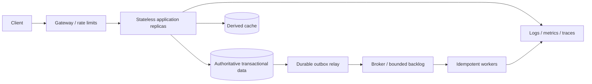

# Module 18 — Distributed system design

**P1/P2 · prerequisite: all earlier failure and ownership boundaries**

System design translates requirements into capacity, data and failure contracts.
Start with the user-visible behavior and estimates, build a simple adequate
architecture, then identify bottlenecks and justify complexity. A diagram cannot
substitute for explaining what happens when one arrow fails.

## Chapter navigation

1. [Requirements and capacity](#requirements-and-capacity)
2. [Scaling and bottlenecks](#scaling-and-bottlenecks)
3. [Replication and sharding](#replication-and-sharding)
4. [Hashing and hotspots](#hashing-and-hotspots)
5. [Consistency, availability and durability](#consistency-availability-and-durability)
6. [Disaster recovery](#disaster-recovery)
7. [Compose the whole path](#compose-the-whole-path)
8. [Optimize the right objective](#optimize-the-right-objective)

## Requirements and capacity

Separate functional behavior from latency, throughput, availability, freshness,
durability, security and cost requirements. Clarify scale, geography, tenant skew,
read/write mix and failure tolerance. Identify which numbers are facts and which
are assumptions to validate.

Ten million events/day average about 116 events/second; a ten-times peak is about
1,160/second. At one decimal kilobyte per event, raw payload is about 10 GB/day
before indexes, replication, metadata and backups. Three copies alone bring payload
storage near 30 GB/day; retention multiplies it further. State units and overhead.

If the average operation takes 200 ms at a stable 1,160/second, Little's Law suggests
roughly 232 in-system operations under matching boundaries. It does not determine
tail latency or the capacity of one database connection. Estimate hot keys, storage,
bandwidth and burst buffer size alongside average requests.

## Scaling and bottlenecks

Vertical scaling increases one machine's resources; horizontal scaling adds units
but introduces distribution/coordination. Stateless API replicas scale more easily
when authoritative state and session assumptions are externalized appropriately.
Load-balancing policies, affinity, connection lifetimes and health checks affect
actual distribution.

Find the limiting resource: CPU, memory, storage IOPS, network, connection pools,
locks, a hot partition or vendor quotas. Scaling the wrong tier can amplify queues.
Use bounded admission and backpressure; buffering buys time, not infinite throughput.
Budget end-to-end latency across serial/parallel calls and failure retries.

## Replication and sharding

Replication copies data for availability/read capacity under defined lag/failover
semantics. Sharding partitions ownership across nodes. Choose a shard key from
access/locality/tenant distribution and future movement requirements.

Tenant-id sharding keeps local tenant operations together but a huge tenant can
dominate one shard. Hashing can spread keys but makes range queries and some joins
harder. Cross-shard transactions/queries, unique identities, resharding, routing
metadata and backup/restore now require explicit protocols.

Do not shard because the final interview diagram looks empty. Estimate the limit
of a simpler database with indexing, partitioning or read replicas first, then
state the trigger that would make data ownership distribution worthwhile.

## Hashing and hotspots

Consistent hashing reduces key movement when members change compared with naive
modulo placement. Virtual nodes can smooth distribution and support different
node capacities, but operational rebalancing and metadata still matter.

It does not split a single extremely hot key automatically. Hotspot remedies can
include replication, key subdivision, local caching or separate placement with
different consistency costs. Salting counters complicates exact reads and atomic
limits. A popular tenant, object or time bucket can defeat balanced average load.

## Consistency, availability and durability

Define read-after-write, monotonic reads, uniqueness, ordering and transactional
invariants per operation. Stronger coordination often costs latency and reduces
operation availability under partitions. Eventual consistency requires convergence
and a conflict/repair policy, not simply permission for incorrect data forever.

Availability is the ability to serve the intended operation; durability concerns
retaining accepted data under specified failures. A highly available endpoint that
acknowledges and loses orders fails a different critical objective. Quorum/consensus
details are P2 specialization here: explain their purpose and assumptions without
claiming a few replicas automatically implement a correct consensus system.

## Disaster recovery

Define RPO and RTO per dataset/capability, backup retention, restore verification
and regional failover ownership. Active-passive is simpler than multi-writer
active-active for many transactional systems. Active-active introduces conflict,
routing, identity and consistency challenges; geographic latency does not vanish.

Plan how clients find the new region, how old writers are prevented from continuing,
which data may be stale/lost and how the system returns to normal. A diagram with
two region boxes is not a recovery drill. Include dependencies such as identity,
secrets, object storage and brokers, not just application replicas.

## Compose the whole path

For every arrow state timeout, retry owner, identity, resource budget, observable
signal and failure outcome. An accepted response must correspond to an explicit
durability point. The cache is derived; the broker does not remove duplicate effects;
workers need scoped concurrency and graceful shutdown.

API/data model choices should follow actual access patterns. Tenant isolation,
authorization, schema evolution and deploy compatibility belong in the initial
design, not a security/operations paragraph added after the system is complete.

## Optimize the right objective

Compare cost, latency, operational complexity and recovery capability. A cache can
reduce reads while adding stale-data rules; microservices can isolate ownership
while adding distributed failure modes; multi-region can improve resilience while
making writes harder. Explain what requirement pays for each cost.

Choose a baseline, show its likely bottleneck, propose an incremental scale step
and record the metric/threshold prompting it. State uncertainty and how a measured
experiment would resolve it. This is stronger than presenting maximum infrastructure
for an unspecified load.

## Worked design studies

The [eight design studies](design-studies.md) cover URL shortening, notifications,
rate limiting, event ingestion, order processing, real-time messaging, document
search/RAG and multi-tenant SaaS. Each includes assumptions, API/data model,
architecture, bottlenecks, recovery and tradeoffs. They are written exercises,
not implemented practical projects.

[AWS reliability guidance](https://docs.aws.amazon.com/wellarchitected/latest/reliability-pillar/welcome.html)
and [SRE Workbook](https://sre.google/workbook/table-of-contents/) support deeper review.

[Practice](practice.md) · [Phase assessment](../assessment.md) ·
[Next: interview coding](../../phase-10/module-19/index.md)
